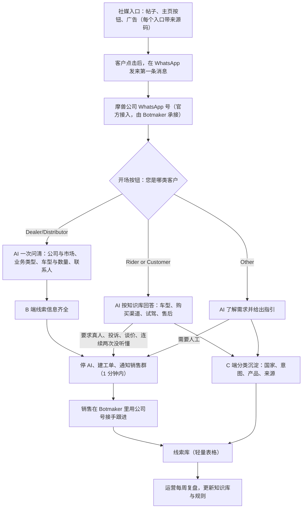

# 摩兽（Tromox）海外社媒 → WhatsApp AI 接待与线索分类 MVP 方案书

> 用途：向摩兽说明第一阶段（MVP）做什么、怎么做、谁来做、怎么验收、费用怎么构成，并逐条回答 Kim 提出的五个问题。读者：Kim 与摩兽管理层（非技术读者）。
> 版本：v0.2，2026-09-22（按平台事实核实更新）。本稿供张宝文修改定稿后转交 Kim；定稿时请删除本行与全部【张宝文确认】标记。
> 标记说明：【待核实】＝平台政策或价格仍在向官方核实；【待客户确认】＝需要摩兽提供或拍板；【张宝文确认】＝商务数字与承诺由张宝文最终确定。
> 假设：正式开工日按 2026-10-12（国庆假期后第一个完整周的周一）计【张宝文确认】；日均咨询量、国家分布、是否投放广告等均未拿到真实数字，文中凡涉及处均为估算。

## 1. 一页摘要

### 1.1 业务价值

1. **统一入口**：海外社媒带来的咨询，全部汇到摩兽公司名下的一个 WhatsApp 号，不再散落在各平台私信和个人手机里。
2. **AI 先接住**：AI 助手全天候应答，回答常见问题、问清关键信息，把杂乱的咨询变成结构化线索（国家、B 端或 C 端、产品需求等）。
3. **B 端不漏、C 端沉淀**：经销商、分销商这类 B 端线索一分钟内推送到销售群，销售用公司号接手；C 端咨询按国家、意图、产品分类沉淀，供后续运营使用。
4. **资产在摩兽名下**：号码、Meta 商务账户、WhatsApp 商业账户、Botmaker 账号全部开在摩兽名下；知识库和规则做成运营自己能改的形式，不被平台或服务方锁住。

### 1.2 链路一句话

社媒流量 → WhatsApp → AI 自动接待 → 识别国家 / B 端或 C 端 / 产品需求 → C 端分类沉淀，B 端线索转销售跟进。详图见第 3 节。

### 1.3 MVP 能做到什么

1. 每个社媒渠道或帖子配一个带来源码的 WhatsApp 链接，知道每条线索从哪里来。
2. 开场用按钮让客户自己选身份（Dealer/Distributor、Rider or Customer、Other），能用按钮就不让 AI 猜。
3. AI 助手只谈摩兽的产品、购买、经销、售后；按知识库回答常见问题；按客户语言自动切换语种（验收语种范围随报价档位）。
4. 国家按手机号国家码判定，不靠猜；对 B 端客户一次问清公司与市场、业务类型、意向车型与数量、联系人。
5. 人工接管第一版就有：停 AI → 建工单 → 通知销售 → 销售在 Botmaker 里用公司号接手。
6. 轻量线索库（表格形式）、销售群通知、标签管理。
7. 夜间和节假日先由 AI 接住，并明确告知客户跟进时限。
8. 客户超过 24 小时未互动时，用经过 Meta 预审的模板消息再次触达。

### 1.4 MVP 做不到什么（第一阶段不做）

1. 不建复杂 CRM，不自建 Agent；先用 Botmaker（Meta 官方 BSP）加轻量线索库验证效果，后期视情况升级。
2. AI 不报经销价、不谈判、不承诺知识库以外的质保条款，这类问题一律转人工。
3. 不做主动群发营销，不做批量导入联系人后的外呼。
4. 暂不接 Instagram、Messenger 私信，暂不做官网咨询组件、CRM 对接、经销商评分，这些放在第二阶段。
5. 不能保证 Meta 的审核时间；也不能保证 AI 零误判。误判靠上线前的评测把关和上线后的每周复盘持续压低，验收有量化指标（见第 9 节）。

### 1.5 您问的五个问题：速答

| # | 您的问题 | 简要回答 | 详见 |
|---|---|---|---|
| 1 | 价格是否包含：搭建、首月维护、Agent 设计与配置、WhatsApp 接入、培训、上线后监护？ | 项目总包价包含：需求梳理、方案设计、Agent 配置、Botmaker 与 WhatsApp 接入、基础分类和标签、测试上线、培训、上线初期调整。"首月维护"和"上线后监护"对应其中的上线初期调整（精简版 2 周，完整版 4 周）。不包含 Botmaker、WhatsApp/Meta 等第三方费用。 | 第 7、11 节 |
| 2 | WhatsApp 账号要不要自己准备？业务在用的号能不能用？要不要找第三方另找号码？一次性添加太多联系人有没有风控风险？ | 账号由摩兽自己准备并开在公司名下，我方协助办理。业务在用的号可以用官方的并存方式（Coexistence）接入，但 MVP 更推荐公司名下新办一个专用号。不需要、也不应从第三方渠道获取号码。风险不来自"添加联系人"，而来自向没有同意接收的人批量发消息；本方案只回复主动来咨询的客户。 | 第 6 节 |
| 3 | 费用是按服务项目总包，还是按时间周期？ | 按项目总包、一次性计价，周期约一个月。第三方平台费用按月由摩兽直付。上线调优期结束后的长期维护按月另行报价。 | 第 11 节 |
| 4 | 后续是否需要长期技术人员，还是普通运营就能维护？ | 不需要长期专职技术人员。更新 FAQ、抽查对话、维护标签、看指标这些日常工作，普通运营经过一场培训即可胜任；只有改动系统对接、适配平台政策变化、排查故障时才需要技术支持，可按月维护或按次支持。 | 第 12 节 |
| 5 | 工程师这类外部资源的报价是多少？ | 以"配置档位 + 包含内容"的方式给出，分精简版与完整版两档；金额【张宝文确认】。 | 《报价单》 |

## 2. 现状与目标

### 2.1 现状（根据 Kim 2026-09-18 的描述整理，细节【待客户确认】）

1. 海外社媒持续带来咨询，其中既有个人骑行者，也有想做经销或分销的商家，混在一起，靠人工逐条分辨。
2. 咨询分散在多个平台和多个人手里，没有统一入口，也没有统一的线索记录。
3. 欧美客户多在国内夜间发来消息，当时无人应答，第二天再回容易错过。
4. 内部目前没有专门负责 Agent 搭建和维护的人。

### 2.2 目标

把链路搭起来并验证一件事：**AI 能不能把 WhatsApp 收到的大量杂乱咨询，自动变成真正有效的、可销售的结构化线索。** 链路本身不难，难点在筛选和分类，所以 MVP 的精力主要放在"什么客户算有效"和"怎么判得准"上。

### 2.3 分工

| 角色 | 由谁承担 | 负责什么 |
|---|---|---|
| 业务负责人 / FDE | 摩兽内部，张宝文协助 | 梳理业务流程和需求，确认 AI 能说什么、不能说什么 |
| 集成工程师 | 外部提供（我方） | WhatsApp、Botmaker、接口对接，AI 助手配置，评测与上线 |
| 销售 / 业务人员 | 摩兽内部 | 提供线索筛选标准，承接 B 端线索 |
| 海外社媒运营 | 摩兽内部（Kim） | 渠道链接投放，知识库内容维护，每周对话抽查 |

## 3. 整体链路

看不到上图时，可按下面的文字理解：

1. **入口**：每个社媒渠道或帖子放一个 WhatsApp 链接，客户点开后输入框里已预填一句带来源码的话，例如 "Hi Tromox! [IG-2609]"，发出即开始对话。
2. **接待**：消息进入摩兽公司号，Botmaker 平台上的 AI 助手先发欢迎语和三个身份按钮。
3. **分流**：点 Dealer/Distributor 的进入 B 端问询；点 Rider or Customer 的进入 C 端答疑；点 Other 的由 AI 了解需求后指引。
4. **交接**：B 端信息问齐后，系统停止 AI、建工单、在一分钟内通知销售群；销售在 Botmaker 里用同一个公司号继续和客户聊。
5. **沉淀**：所有咨询都按国家、客户类型、产品、来源写入线索库并打标签。
6. **迭代**：运营每周抽查对话，把答错、判错的情况反馈回来，更新知识库和规则。

## 4. 客户体验示例

下面三段对话中的英文，是计划上线的实际话术。花括号内为占位内容，上线前替换；工作时间与答复时限为默认值【待客户确认】。涉及车型参数、价格、质保的内容一律来自摩兽提供的知识库，示例中不编造。

### 4.1 B 端：德国经销商从 Instagram 进来

旁白：客户在 Instagram 主页点了 WhatsApp 链接，预填消息自带来源码 IG-2609。

> **客户**：Hi Tromox! [IG-2609]
>
> **AI 助手**：Welcome to Tromox. I'm the Tromox virtual assistant (AI). I can help with our electric motorcycles, where to buy, dealership enquiries and after-sales support. We use your messages only to handle your enquiry: {privacy_url}. Which best describes you?
> （按钮）Dealer/Distributor ｜ Rider or Customer ｜ Other
>
> **客户**：（点击）Dealer/Distributor
>
> **AI 助手**：Thanks for your interest in partnering with Tromox. So our sales team can prepare, please tell me in one message: 1) your company name and country or market, 2) your business type (dealer, distributor, importer, fleet or rental), 3) which models and roughly how many units you are considering, 4) your name and role.
>
> **客户**：We are Example Moto GmbH from Hamburg, Germany. We run two scooter shops, so dealer. Interested in MC10 and Ukko, around 20 units for next season. I'm Markus, the owner.
>
> **AI 助手**：Thank you, Markus. I have passed your details to our sales team. A Tromox sales manager will reply here, on this WhatsApp number, within one business day. Our team works Monday to Friday, 09:00-18:00 China time (UTC+8). If you would like to add anything, just reply here.

旁白：AI 只用了三条消息就把信息问齐。与此同时，销售群在一分钟内收到一张线索卡片：

| 项 | 内容 |
|---|---|
| 线索类型 | B 端，经销商（dealer） |
| 国家 | 德国（手机号国家码 +49，与客户自述一致） |
| 公司与联系人 | Example Moto GmbH，Markus（owner） |
| 需求 | MC10、UKKO，约 20 台，下一季 |
| AI 摘要 | 德国汉堡经销商，两家门店，想经销 MC10 与 UKKO，首批约 20 台；建议销售尽快用公司号回复 |
| 来源 | Instagram，来源码 IG-2609 |
| 客户号码 | 仅显示尾号，完整号码在 Botmaker 内查看 |
| 回复截止 | 客户最后一条消息后 24 小时内 |

销售点开卡片上的链接，在 Botmaker 里用公司号接着聊，客户看到的始终是同一个摩兽官方号。

### 4.2 C 端：意大利骑行者想试驾

> **客户**：（点击）Rider or Customer
>
> **AI 助手**：Happy to help. What would you like to know?
> （按钮）Buy / Find a dealer ｜ Test ride ｜ Support
>
> **客户**：（点击）Test ride，并输入：I'm in Milan, can I try the MC10 somewhere?
>
> **AI 助手**：{知识库答案：米兰附近的授权经销商与试驾预约方式，由摩兽提供的经销商名单生成}
>
> **客户**：By the way, can you help me write an email to my landlord?
>
> **AI 助手**：I can only help with Tromox products, purchasing, dealership and after-sales questions. Is there anything about Tromox I can help you with?

旁白：这条咨询不打扰销售，自动沉淀为：意大利、C 端、试驾意向、MC10、来源 Instagram。与摩兽无关的问题被礼貌拒答，这既是品牌形象的需要，也是 Meta 对 AI 机器人的合规要求（见第 6.4 节）。

### 4.3 夜间：美国客户在北京时间凌晨发来询价

旁白：北京时间凌晨 5 点左右（美国西海岸当地下午），一位做租赁车队的客户点了 Dealer/Distributor，回答完基本信息后直接要价格表。

> **客户**：Please send me your dealer price list and MOQ.
>
> **AI 助手**：I can't quote dealer prices or confirm warranty terms in chat. I'll connect you with our team for that. Thanks for your message. Our team is offline right now (working hours: Monday to Friday, 09:00-18:00 China time (UTC+8)). I've recorded your request and a colleague will reply here within one business day. Meanwhile I can answer questions about our models and where to buy.

旁白：AI 不报价，但把客户接住了，并在同一条消息里说清楚什么时候有人回复（按条计费之后，能一条说完的不拆成两条）。销售群当时就收到通知，卡片上写明"回复截止时间"。销售上班后在当天 10:00 前用公司号回复即可；如果超过 24 小时没人回，就只能用预审过的模板消息再联系客户，所以这个时限要当成硬规矩（见《销售接手SOP》）。

## 5. AI 如何分类与交接

### 5.1 三个识别点，各用最稳的办法

| 要识别什么 | 用什么办法 | 为什么 |
|---|---|---|
| 国家 | 按手机号国家码判定；只对 B 端客户追问确认"您的市场是哪个国家" | 号码国家码是确定的事实，AI 根据语言或城市去猜反而容易错 |
| B 端或 C 端 | 客户自己点按钮；只有客户不点按钮、直接打字时才由 AI 判断 | 客户自己选的最准，也省一轮对话 |
| 产品需求 | AI 从对话中识别车型名称，对照摩兽的产品目录归类 | 客户写法五花八门，这是 AI 擅长的事 |

### 5.2 宁可多送，不可漏掉

两类错误的代价不一样：把一个个人客户误送给销售，销售多看一眼就过去了；漏掉一个真正的经销商，损失的可能是一个市场。所以规则定为：**拿不准时按 B 端处理，并转人工确认。** 验收指标也以"B 端找得全"为第一指标（见第 9 节）。

### 5.3 什么时候转人工

1. 客户明确要求和真人沟通。
2. B 端客户的关键信息已经问齐。
3. AI 对判断没有把握。
4. 涉及投诉、质保争议、法律、人身或电池安全。
5. 客户要谈价格、要经销价、要报价单。
6. AI 连续两次没听懂客户的话。

### 5.4 交接四步

| 步骤 | 系统做什么 | 目的 |
|---|---|---|
| 1. 停 AI | 该客户的对话不再由 AI 回复 | 避免 AI 和销售同时说话 |
| 2. 建工单 | 在 Botmaker 里生成一张工单，带上已收集的信息 | 有记录、可追踪、不丢单 |
| 3. 通知销售 | 线索卡片发到销售群（飞书或企业微信，【待客户确认】），目标 1 分钟内送达 | 销售第一时间知道 |
| 4. 销售接手 | 销售在 Botmaker 里用公司号继续对话 | 客户始终面对同一个官方号 |

接手一律在公司号上完成，**不转到销售个人的 WhatsApp**。这样客户资源留在公司，聊天记录完整，人员变动也不影响跟进。

### 5.5 AI 的边界

1. 开场即表明自己是 AI 助手。
2. 只谈摩兽的产品、购买、经销、售后；其他话题礼貌拒答并引导回来。
3. 只按知识库回答；知识库里没有的，不编，转人工。
4. 不报经销价，不承诺质保条款，除非知识库里有摩兽明确允许对外说的口径。

### 5.6 分类质量怎么保证

上线前，用摩兽自己的 100 至 200 条历史咨询做一轮"离线评测"：请销售先标出每条咨询的正确答案，再让 AI 判一遍，对比结果，反复调整，直到达到验收阈值才上线。评测和正式上线使用同一个 AI 模型、同一版规则。上线后每周抽查真实对话，持续修正。

## 6. WhatsApp 账号与合规

### 6.1 官方接入的要求

本方案走 Meta 官方的 WhatsApp Business Platform（由官方 BSP Botmaker 承接）。官方接入有几条硬性要求：

1. 号码必须注册在摩兽自己的 Meta 商务账户下，接入时要用这个号码接收验证码。
2. 企业要通过商家认证（Business Verification，Meta 核验企业真实身份），号码的显示名（客户看到的商家名称）要通过审核。
3. 号码有发送量分级和质量评级：分级只限制企业主动发起的消息，回复客户主动发来的咨询不受限；被客户大量拉黑或举报，质量评级会下降，额度就升不上去；违反平台政策时整个账户可能被限制。
4. AI 机器人必须是限定用途的（见第 6.4 节）。

### 6.2 两种官方接入方式

| | 方式 a：公司名下新办一个专用号，直接走官方接口（MVP 推荐） | 方式 b：现有 WhatsApp Business App 号码，通过 Coexistence（并存）接入 |
|---|---|---|
| 是什么 | 以公司名义新办一个号码，专门用于 AI 接待和销售接手 | 同一个号码同时在手机 App 和 Botmaker 平台上使用，官方支持，Botmaker 也支持 |
| 适合什么情况 | 现有业务号上有重要老客户和历史记录，不希望受试点影响；希望 AI 接待和原有沟通清晰分开 | 现有号码已经印在社媒主页、名片、官网上，客户只认这个号；希望保留历史聊天和联系人 |
| 好处 | 干净、无历史包袱；试点风险与现有业务隔离；没有并存方式的功能限制 | 老客户无感；可同步近 6 个月的聊天记录；销售仍可在手机 App 上回复 |
| 需要注意 | 号码要能接收短信或语音验证码，且没有在 WhatsApp 上注册过（注册过需先注销）；社媒入口的链接要换成新号 | App 版本需 2.24.17 及以上；接入当天持机人要在场扫码；之后至少每 14 天打开一次 App，否则连接会断开；模板消息只能从平台发送；广播列表停用，一对一聊天中的阅后即焚、一次性查看、实时位置会被关闭；群聊不进入平台；Meta 已取消此前的国家限制，中国大陆号码以实际接入结果为准【待核实】 |
| 日常协作 | AI 和销售都在 Botmaker 里，职责清晰 | 需要约定"谁接手谁回复"，避免手机端和平台端同时回复同一个客户 |

建议：MVP 用方式 a 起步；如果现有号码已经是主要对外入口，则选方式 b。也可以先 a 后 b：先用新号把链路跑通，再把老号并入。最终选择【待客户确认】，建议在中秋碰面时确定。

### 6.3 逐条回答账号相关的四个问题

**（1）WhatsApp 账号是否需要摩兽自己准备？**
需要。号码、Meta 商务账户、WhatsApp 商业账户、Botmaker 账号全部开在摩兽名下，摩兽是所有者。Meta 商务账户默认不需要给我方开管理权限：接入号码时由摩兽的 Meta 商务账户管理员本人登录完成授权，确需我方协助时临时以最小权限加入、用完即移除。Botmaker 后台在交付期与维护期内为我方保留一个操作席位（配置 AI 助手和知识库要用），账号所有者始终是摩兽，项目结束可随时移除。第三方平台费用也由摩兽直接支付。这样项目结束或更换服务方时，所有资产都在摩兽手里。

**（2）业务在用的 WhatsApp 能不能用？**
能。官方提供并存方式（Coexistence），Botmaker 官方支持，条件见上表方式 b。是否选用，主要取决于这个号码对现有业务有多重要；Meta 已取消此前的国家限制，若是中国大陆号码，以实际接入结果为准【待核实】。

**（3）要不要从第三方渠道另找号码？**
不需要，也不应该。官方接入的要求是号码注册在企业自己的 Meta 商务账户下，能接收验证码，并与通过商家认证的企业主体一致。来源不清的号码满足不了这些要求，归属权也不在摩兽手里，随时可能失效。正确做法只有两种：公司名下新办，或沿用公司现有的业务号。

**（4）一次性添加太多联系人，是否有风控风险？**
官方接入方式下没有"批量添加联系人"这个动作，风险不来自"添加"。真正触发风控的是：向没有同意接收的人批量发消息。对方拉黑、举报多了，号码的质量评级会下降，发送上限被调低，严重时号码被封停。本方案是"客户先来找我们"的模式：

1. 只回复主动发来咨询的客户。
2. 客户最后一条消息后的 24 小时内可以自由回复。
3. 超过 24 小时，只能给同意接收的客户发经过 Meta 预审的模板消息。
4. 不做冷启动群发，不导入外部名单外呼。

另外提醒：如果现有业务号过去在手机 App 上一次性添加大量陌生联系人并群发，同样存在被限制的风险，建议停止这类做法。

### 6.4 合规要点（通俗版）

| 要点 | 说明 |
|---|---|
| 限定用途的 AI | Meta 自 2026 年 1 月起禁止在 WhatsApp 商业接口上运行"什么都能聊"的通用型 AI 机器人；客服、线索筛选、售后这类限定用途的机器人明确允许。本方案的 AI 只谈摩兽业务，其他话题一律拒答 |
| 24 小时客服窗口 | 客户最后一条消息后的 24 小时内可以自由回复；窗口关闭后只能发预审过的模板消息 |
| 模板与同意 | 再触达模板用于跟进客户自己发起的咨询，不含促销内容；营销类消息只发给明确同意接收的客户 |
| 对话数据不用于训练 AI | Meta 条款要求客户对话数据不得被用于训练或改进 AI 模型；选用的模型服务按此要求配置 |
| 隐私 | 开场消息附隐私政策链接【待客户确认】；只收集业务必需的信息；客户要求删除时按流程删除；发到销售群的卡片默认隐藏完整号码。欧盟客户占比较高，建议摩兽法务复核隐私告知与数据存放安排【待客户确认】 |

### 6.5 计费规则变化（2026-10-01 起）

自 2026-10-01 起，Meta 对 24 小时客服窗口内企业发出的每一条自由回复按条收费，人工回复和 AI 回复都算，单价按客户所在国家确定。MVP 上线必然在此之后，所以费用估算已按新规则计算（见第 11 节）。两点利好：由 Click-to-WhatsApp 广告或 Facebook 主页按钮进入的对话，72 小时内的消息免费；每个号码每月前 1,000 条窗口内回复免费，Meta 官方已公布，按月重置、不结转。

## 7. 交付内容与范围

项目总包包含以下八项，与此前沟通的口径一致：

| # | 包含项 | 具体做什么 | 交付物 |
|---|---|---|---|
| 1 | 需求梳理 | 把"咨询怎么接进来、什么客户算有效、销售怎么接手"三个流程过一遍并成文；确认 AI 能说什么、不能说什么 | 需求确认单、有效线索标准 |
| 2 | 方案设计 | 整体链路、对话流程、分类与交接规则、线索字段与标签体系、来源追踪方案 | 方案与流程说明 |
| 3 | Agent 配置 | AI 助手的限定用途设定、开场与按钮分流、FAQ 知识库导入、多语种应答、转人工规则 | 可对话的 AI 助手 |
| 4 | Botmaker 与 WhatsApp 接入 | 协助摩兽在自己名下完成 Meta 商务账户、商家认证、号码接入（新号或并存方式）、Botmaker 开通、销售坐席与权限；打通轻量线索库与销售群通知 | 已接入的公司号、线索库、通知 |
| 5 | 基础分类和标签 | 国家、B 端或 C 端、产品需求的识别；线索信息抽取；标签；每个渠道的来源码 | 分类规则、标签清单、渠道链接表 |
| 6 | 测试上线 | 用历史咨询做离线评测；多语言与边界测试；20 个端到端验收场景；先小范围后全量上线 | 评测报告、验收记录 |
| 7 | 培训 | 运营一场、销售一场；配套《运维手册》《销售接手SOP》 | 培训与文档 |
| 8 | 上线初期调整 | 上线后的调优期内每周复盘误判，调整 AI 规则与知识库（精简版 2 周，完整版 4 周） | 每周复盘记录 |

不包含：Botmaker、WhatsApp/Meta 等第三方费用，由摩兽另付并直接支付给平台。

两档配置的差别（语种范围、标签范围、调优周期等）和其他范围外事项见《报价单》。具体包含多少定制开发、调优多久，待需求过一遍后确定【张宝文确认】。

## 8. 客户需要提供什么

完整清单见《客户需提供清单》。最要紧的是**节前三件事**：

| # | 事项 | 为什么急 | 建议完成时间 |
|---|---|---|---|
| 1 | 启动 Meta 商家认证 | 审核时间由 Meta 决定，是整个项目里最不可控的一环；材料要在国庆假期前提交 | 2026-09-30 前提交 |
| 2 | 整理 100 至 200 条历史咨询 | 用来评测和调整 AI 的分类，没有真实数据就无法验证"判得准不准" | 2026-10-09 前 |
| 3 | 销售写下"有效线索标准" | 什么样的经销商算有效、哪些国家优先、哪些直接排除，这是 AI 筛选的依据 | 2026-10-09 前 |

开工前还需要：Meta 商务账户管理员、号码、产品目录、可对外说的价格与质保口径、各国经销商名单、FAQ 素材、品牌语气要求、销售名单与工作时间、协作工具（飞书或企业微信）、隐私政策链接。

## 9. 验收标准

验收用数字说话。下列阈值均为建议值【张宝文确认】，详细口径由我方另附验收标准文件。

### 9.1 分类质量（用摩兽的真实历史咨询评测）

| 指标 | 通俗解释 | 阈值 |
|---|---|---|
| 评测集规模 | 用真实历史咨询，由销售标注正确答案 | 不少于 150 条【张宝文确认】 |
| B 端找得全（主指标） | 100 条真正的 B 端咨询里，AI 至少认出 90 条 | 不低于 90%【张宝文确认】 |
| B 端找得准 | AI 判为 B 端的咨询里，至少 80% 确实是 B 端 | 不低于 80%【张宝文确认】 |
| 国家判断准确率 | 有手机号国家码的咨询中，国家判对的比例 | 不低于 95%【张宝文确认】 |
| 产品需求识别率 | 客户提到的车型被正确识别的比例 | 不低于 85%【张宝文确认】 |
| 转人工比例 | 需要人工接手的咨询占比，太高说明 AI 没帮上忙 | 不高于 30%【张宝文确认】 |

### 9.2 全链路

| 指标 | 阈值 |
|---|---|
| 端到端验收场景 | 20 个场景全部通过，覆盖不少于 3 个语种（精简版为 2 个语种）【张宝文确认】 |
| B 端线索确认到销售收到通知 | 不超过 60 秒【张宝文确认】 |
| 人工接管全流程 | 停 AI、建工单、通知销售、销售用公司号接手，现场演示通过 |
| 话题收口与不报价 | 无关话题被礼貌拒答；不报经销价、不承诺知识库以外的质保条款 |

### 9.3 可维护性与交付

1. 运营人员能不经技术人员更新知识库：现场新增一条、修改一条 FAQ 并验证生效。
2. 销售能独立完成一次接手和线索状态回写。
3. 文档与培训交付齐全。
4. 所有账号在摩兽名下，摩兽为所有者。

### 9.4 验收节点

| 节点 | 时间 | 内容 |
|---|---|---|
| 上线验收 | 2026-11-06 | 9.1 至 9.3 全部项 |
| 调优结束验收 | 精简版 2026-11-22；完整版 2026-12-04 | 用上线后的真实对话抽样复测分类质量，遗留问题清零 |

Meta 的审核通过时间、第三方平台故障、因素材未提供造成的知识库空缺，不计入验收。

## 10. 时间计划

| 阶段 | 日期 | 做什么 | 主要负责 |
|---|---|---|---|
| 客户准备 | 2026-09-22 至 2026-10-11 | 节前三件事；中秋线下碰面（2026-09-25 前后）捋三个流程；2026-09-30 前提交 Meta 商家认证 | 摩兽、张宝文 |
| 节点 | 2026-10-01 | Meta 客服消息按条计费生效；国庆假期 2026-10-01 至 2026-10-07 | |
| 第 1 周 | 2026-10-12 至 2026-10-18 | 正式开工【张宝文确认】；开通 Botmaker、接入号码；用历史咨询做离线评测 | 集成工程师 |
| 第 2 周 | 2026-10-19 至 2026-10-25 | 搭建 AI 助手：开场分流、知识库、转人工规则、标签；提交再触达模板审核 | 集成工程师、摩兽运营 |
| 第 3 周 | 2026-10-26 至 2026-11-01 | 线索库与销售群通知；多语言测试；2026-10-30 起验收测试 | 集成工程师、摩兽销售 |
| 第 4 周 | 2026-11-02 至 2026-11-08 | 2026-11-02 运营培训；2026-11-03 销售培训；2026-11-04 上线（先放一个渠道）；2026-11-06 上线验收 | 全体 |
| 调优期 | 2026-11-09 起 | 每周复盘误判、调整规则与知识库；精简版至 2026-11-22，完整版至 2026-12-04 | 集成工程师、摩兽运营 |

两点说明：

1. **Meta 商家认证与显示名审核是关键路径**，也是唯一不受我们控制的环节。Meta 官方说法是快则几分钟、最长 14 个工作日，被退回重交可能拖到数周，所以必须在开工前由摩兽启动。
2. 历史咨询和有效线索标准若不能在开工前到位，离线评测顺延，后面各周整体后移。

## 11. 费用结构

费用分三块，互相独立：

| 费用块 | 怎么计 | 付给谁 | 金额 |
|---|---|---|---|
| 项目总包 | 按项目一次性计价，周期约一个月，外加上线初期调整 | 我方 | 【张宝文确认】 |
| 第三方费用 | 按月，按实际用量 | 摩兽直接付给 Botmaker、Meta 等平台 | 估算见下 |
| 长期维护（可选） | 调优期结束后按月 | 我方 | 另行报价【张宝文确认】 |

### 11.1 回答问题 1：价格包含哪些

| Kim 问到的项目 | 是否包含在总包内 | 说明 |
|---|---|---|
| 搭建 | 包含 | 对应第 7 节的 Agent 配置、Botmaker 与 WhatsApp 接入、基础分类和标签 |
| 首月维护 | 包含上线初期调整 | 精简版 2 周、完整版 4 周，完整版基本覆盖上线后首月；调优期之后的长期维护另行报价【张宝文确认】 |
| Agent 设计与配置 | 包含 | 对应方案设计、Agent 配置 |
| WhatsApp 接入 | 包含 | 协助办理，账号在摩兽名下；Meta 审核时间不由我方控制 |
| 培训 | 包含 | 运营、销售各一场 |
| 上线后监护 | 包含 | 即上线初期调整：每周复盘误判，调整 AI 规则与知识库 |
| Botmaker、WhatsApp/Meta 等第三方费用 | 不包含 | 摩兽直接支付给平台 |

### 11.2 回答问题 3：总包还是按周期

按**项目总包**一次性计价，不按时间周期收费。建议分三次付款：开工 30%、上线验收 40%、调优结束 30%【张宝文确认】。需求变更按工作量另行报价。

### 11.3 回答问题 5：外部工程师资源的报价

以"配置档位 + 包含内容"的方式给出，分精简版与完整版两档，差别在语种范围、标签范围和调优周期；金额【张宝文确认】，见《报价单》。

### 11.4 第三方费用估算（客户直付第三方）

以下为估算【待核实】，按 2026-10-01 之后的计费规则计算；拿到摩兽真实的咨询量、国家分布和广告投放情况后会重新测算。

| 情景 | 假设日均咨询 | 每月约（USD） | 每月约（CNY） |
|---|---|---|---|
| 低 | 10 个 | 180 | 1,250 |
| 中 | 30 个 | 350 | 2,470 |
| 高 | 120 个 | 1,830 | 13,030 |

另有一次性费用：Botmaker 开通 WhatsApp 商业平台账户 99 USD。费用构成（Botmaker 套餐、WhatsApp 消息费、AI 用量费、托管费）的分项见《报价单》。

三个直接影响费用的动作：

1. **话术一条说清、多用按钮。** 每个对话多发几条消息，月费用会明显上升，所以话术设计本身就是成本控制。
2. **投放尽量用 Click-to-WhatsApp 广告。** 从这类广告进来的对话 72 小时内免费。
3. **高费率国家占比越高越贵。** 例如德国的单条费用是巴西的数倍，真实国家分布出来后估算可能变化较大。

## 12. 上线后谁来维护

结论：**不需要长期专职技术人员。** 知识库和规则做成运营可以直接修改的形式，日常维护是运营的工作；只有改动系统对接时才需要技术。

| 工作 | 谁来做 | 频率 | 需要技术吗 |
|---|---|---|---|
| 更新 FAQ、产品信息、经销商名单 | 运营，业务负责人审核 | 随时 | 不需要 |
| 抽查 20 至 30 条对话，记录答错、判错的情况 | 运营 | 每周 | 不需要 |
| 新渠道、新帖子生成带来源码的链接 | 运营 | 随时 | 不需要 |
| 标签维护、看数据指标 | 运营 | 每周 | 不需要 |
| 接手 B 端线索、回写线索状态 | 销售 | 每天 | 不需要 |
| 更换通知工具、对接 CRM、调整线索字段 | 技术 | 偶发 | 需要 |
| 平台政策或计费规则变化后的调整 | 技术 | 偶发 | 需要 |
| 故障排查（AI 不回复、线索不入库、通知中断） | 技术 | 偶发 | 需要 |
| AI 规则的结构性调整、新增语种 | 技术 | 偶发 | 需要 |

具体操作见《运维手册》。技术支持可以按月维护，也可以按次支持，见《维护服务说明》。

另外，AI 的规则（提示词）、知识库内容、标签体系、流程说明全部以文件形式保存并交付，不锁在平台里；将来换平台或自建，可以直接迁移。

## 13. 风险与应对

| # | 风险 | 通俗解释 | 应对 |
|---|---|---|---|
| 1 | Meta 审核延误 | 商家认证和显示名审核由 Meta 决定，可能被退回 | 国庆假期前提交；按清单备齐材料；审核期间先完成其他工作；认证通过前也能回复客户主动发来的咨询，入站接待可以先上线，只是显示名在审核通过前不会出现在聊天顶部 |
| 2 | 号码被限制或封停 | 被大量拉黑、举报会降低号码评级 | 只回复主动来咨询的客户；不群发；模板只发给同意接收的客户；不采用第三方购号，所有号码与账号均在摩兽名下办理 |
| 3 | 计费规则变化 | 2026-10-01 起按条计费，费用与消息条数挂钩 | 话术一条说清、多用按钮；引导用 Click-to-WhatsApp 广告；每月核对账单并复核估算 |
| 4 | AI 误判，尤其是漏掉经销商 | AI 不是百分之百准确 | 身份由客户点按钮；拿不准按 B 端转人工；上线前评测达标；上线后每周复盘 |
| 5 | 销售没在 24 小时内回复 | 超时后只能发模板消息，体验打折 | 通知卡片写明回复截止时间；约定响应时限与周末值班；备好再触达模板 |
| 6 | AI 合规 | Meta 禁止通用型 AI 机器人 | AI 限定只谈摩兽业务，开场表明 AI 身份，其他话题礼貌拒答 |
| 7 | 语种覆盖不足 | 小语种回答质量可能不稳定 | 先保证主要语种的测试与验收；其余语种 AI 可应答但不计入验收，逐步扩展 |
| 8 | 资料准备不足 | 没有历史咨询和有效线索标准，就无法验证分类质量 | 节前三件事提前启动；不到位则评测和后续工作顺延 |
| 9 | 平台方沟通 | Botmaker 主要市场在拉美，英语、西语、葡语服务，美元计价，有时差 | 由我方负责与平台沟通；关键问题书面确认；保留迁移到其他官方 BSP 的能力 |
| 10 | 被平台锁定 | 配置都在平台里，换平台成本高 | AI 规则、知识库、标签体系、流程说明以文件形式保存并交付 |
| 11 | 隐私合规 | 欧盟客户的个人数据有专门要求 | 隐私告知、只收必要信息、删除请求流程；建议法务复核【待客户确认】 |
| 12 | 网络访问 | Meta、WhatsApp、Botmaker 后台从中国大陆访问需要跨境网络 | 沿用摩兽海外社媒团队现有的合规跨境网络环境；访问稳定性【待核实】 |
| 13 | 需求蔓延 | 做着做着范围越来越大 | 范围以《报价单》为准；新增需求按工作量另行报价，或放入第二阶段 |

## 14. 第二阶段展望

MVP 验证有效后，可以视情况升级，以下均不在第一阶段范围内，费用另行评估【张宝文确认】：

1. 与 CRM 或官网对接，线索自动流转。
2. Dealer/Distributor 线索评分与优先级排序。
3. FAQ 知识库扩展到更多产品与语种。
4. 接入 Instagram、Messenger 私信，统一在一个后台处理。
5. 官网咨询组件。
6. 数据看板：来源、国家、转化。
7. 面向已同意客户的主动再触达。
8. 咨询量和复杂度上去之后，再评估是否自建。

## 附录：术语表

| 术语 | 解释 |
|---|---|
| BSP | Business Solution Provider，Meta 官方授权的 WhatsApp 商业接口服务商。Botmaker 是其中之一 |
| Botmaker | 本方案使用的平台，负责承接 WhatsApp 消息、运行 AI 助手、提供销售接手的工作台 |
| 24 小时客服窗口 | 客户最后一条消息后的 24 小时内，企业可以自由回复；超过后只能发模板消息 |
| 模板消息 | 事先提交 Meta 审核通过的固定格式消息，用于窗口关闭后联系客户，按条收费 |
| CTWA | Click-to-WhatsApp，点击后直接打开 WhatsApp 对话的 Facebook 或 Instagram 广告；从这类广告进来的对话 72 小时内消息免费 |
| Coexistence | 并存方式：同一个号码同时在 WhatsApp Business 手机 App 和官方接口平台上使用 |
| 商家认证 | Business Verification，Meta 对企业真实身份的核验，需要营业执照等材料 |
| 显示名 | 客户在 WhatsApp 里看到的商家名称，需要 Meta 审核，须与企业或品牌一致 |
| 质量评级 | Meta 根据客户拉黑、举报情况给号码的评级，影响发送上限 |
| 来源码 | 放在预填消息里的一小段代码，例如 IG-2609，用来识别客户从哪个渠道进来 |
| 工单 | Botmaker 里记录一次待人工处理事项的单据，可分配、可追踪 |
| 知识库 | AI 回答问题所依据的资料库，由摩兽提供内容，运营可以随时更新 |
