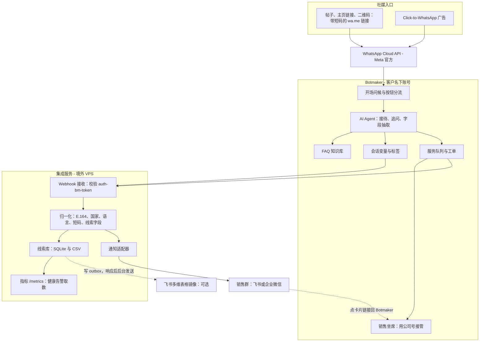
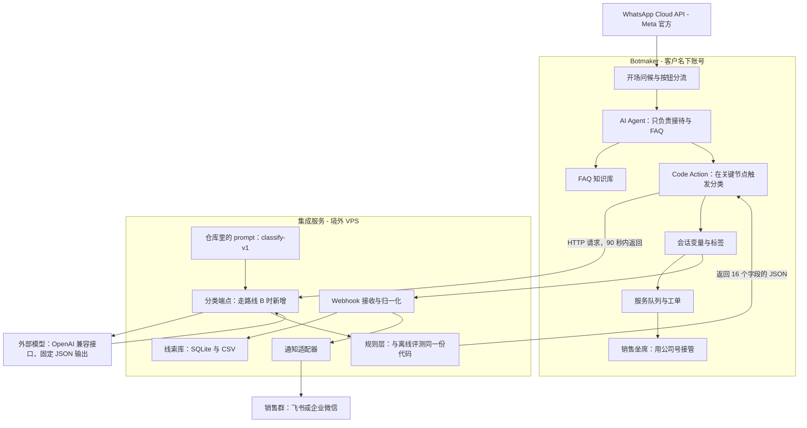

# 总体架构

> 用途：说明 MVP 的组件、两条 AI 路线（A / B）的架构图、数据流、资产归属与明确不做的事。读者：集成工程师、张宝文。
> 假设：平台为 Botmaker（见 `adr/0001-platform-choice.md`）；集成服务部署在境外小型 VPS（见 `05-integration/deployment.md`）；平台事实一律引用 `SOURCES.md` 的条目编号。

## 1. 设计原则

| # | 原则 | 在架构里的体现 |
|---|---|---|
| 1 | 官方接入 | 只走 Meta 官方 Cloud API 与官方 BSP（SOURCES S-B1） |
| 2 | 限定用途的 AI | AI 只谈摩兽产品、购买、经销、售后，其余礼貌拒答（SOURCES S-M5） |
| 3 | 平台优先不自建 | 对话、知识库、队列、工单、坐席全部用 Botmaker 现成能力；自写代码只有一个集成服务 |
| 4 | 能用按钮就不让 AI 猜 | B 端或 C 端由客户按按钮；国家由号码国家码按规则判定 |
| 5 | 验收可量化 | 指标与阈值见 `06-acceptance/acceptance-criteria.md` |
| 6 | 资产在客户名下 | 见第 5 节 |
| 7 | 反锁定 | prompt、知识库、标签体系、流程说明全部以文件形式留在本仓库 |

## 2. 路线 A（默认）：Botmaker 内置 AI Agent 抽取字段

要点：

1. AI Agent 按指令把抽取结果写进与线索字段同名的会话变量（SOURCES S-B9）；Botmaker 的 webhook 在"包含变量"打开时把变量随消息一起回调（SOURCES S-B5、S-B6）。
2. 集成服务不参与对话，只做"接收、归一化、入库、通知"。它宕机时对话照常，只是线索入库与通知中断；宕机期间的回调未必补得回：Botmaker 对单条失败是否重发未知【待核实】，10 分钟内失败超过 100 次还会熔断 10 分钟、期间的回调丢失（SOURCES S-B5）。所以健康检查要告警，缺口靠对账补（`05-integration/botmaker-api-notes.md` 第 7 节）。
3. 销售接管发生在 Botmaker 坐席界面，用的是公司号；通知卡片只是提醒，不承载对话。

## 3. 路线 B（内置抽取不稳定时）：外部固定 JSON 调用

要点：

1. 只把"分类 + 抽字段"单拎出来做成一次外部调用，对话与 FAQ 仍由内置 AI Agent 承担，所以路线 B 的增量成本只有外部模型费（见 `03-whatsapp/cost-model.md` 第 3 节第 13 条）。
2. Code Action 可调外部 HTTP、单次执行上限 90 秒（SOURCES S-B10）；调用频率上限【待核实】。
3. 外部调用有两种落点：Code Action 直接调模型接口，或调集成服务的分类端点再由服务调模型。**采用后者**：prompt、密钥、JSON 解析、规则层都留在仓库代码里，与离线评测走同一份代码，满足"离线评测与生产同一模型、同一版 prompt"。该端点不在 MVP 脚手架内，决策门判定走路线 B 时再加。
4. 发给外部模型的内容只含对话文本，不含手机号；模型方须有"不用于训练"的条款（SOURCES S-M5）。
5. 走哪条路线由决策门决定：试用账号 20 条样例，字段写入成功率不低于 95% 走 A，否则走 B（`adr/0003-ai-route-a-b.md`、`06-acceptance/acceptance-criteria.md` 第 4 节）。

## 4. 组件说明

| 组件 | 职责 | 归属 | 备注 |
|---|---|---|---|
| 社媒入口 | 每个渠道、帖子一条带短码的 wa.me 链接；广告走 Click-to-WhatsApp | 客户运营 | 规则见 `source-tracking.md` |
| WhatsApp Cloud API | 官方消息通道；24 小时客服窗口与模板规则在这一层生效 | Meta，账户在客户名下 | 计费见 SOURCES S-M1 |
| Botmaker Flow | 开场问候、按钮分流、非工作时间话术、转人工动作 | Botmaker，客户为所有者 | 话术见 `conversation-flow.md` |
| Botmaker AI Agent | 理解自由文本、答 FAQ、追问、抽取字段；单 Agent，不做多 Agent | 同上 | system prompt 见 `02-botmaker/ai-agent-system-prompt.md` |
| FAQ 知识库 | AI 回答的唯一依据；运营可自行更新 | 同上 | 模板见 `02-botmaker/knowledge-base-template.md` |
| 服务队列与工单 | 承接转人工；销售在坐席界面用公司号回复 | 同上 | 规则见 `routing-rules.md` |
| 集成服务 | 接收 webhook、归一化、按号码去重入库、发销售群通知 | 客户（部署在客户付费的 VPS 上） | 代码见 `05-integration/webhook-service/` |
| 线索库 | 结构化线索，字段见 `lead-schema.md` | 客户 | 选型见 `adr/0004-lead-storage.md` |
| 销售群通知 | 60 秒内把 B 端线索摘要推给销售；号码默认打码 | 客户现有协作工具【待客户确认】 | 选型见 `adr/0005-notification-channel.md` |
| 离线评测工具 | 用标注数据度量分类质量，管 prompt 版本 | 本仓库 | `04-eval/` |
| 共享规则包 | 字段、枚举、国家、语言、短码、升级规则的唯一实现 | 本仓库 | `shared/tromox_lead/`，评测与生产共用 |
| 指标端点 `/metrics` | 按同一个 Token 鉴权，返回最近 24 小时的处理结果、通知状态、未处理回调与待发镜像的计数 | 客户（随集成服务部署） | 口径见 `05-integration/webhook-service/README.md` 第 1 节「指标」一行 |
| 镜像 outbox（远程 sink 异步） | 线索入库后只登记一行待发，HTTP 响应发出之后由后台任务发送远程镜像，失败留给 `app.replay` 重试 | 同上 | 决策见 `adr/0007-remote-mirror-async-outbox.md` |
| 周报 `app.report`（可推送） | 从线索库出每周六项指标的 Markdown 与 JSON，加 `--post` 把摘要推到销售群 | 本仓库，跑在客户的 VPS 上 | 指标口径与 cron 写法见 `05-integration/webhook-service/README.md` 第 10 节 |
| 演示卡片 `app.demo` | Botmaker 开通前离线回放 UAT 用例，产出销售群卡片样张给客户看 | 本仓库 | 产物清单见 `05-integration/webhook-service/README.md` 第 11 节 |
| 删除请求 `app.forget` | 按号码或 `lead_id` 把一个联系人从账本、CSV 与镜像里一次删净；先预演再确认 | 客户运维 | 合规承诺见 `03-whatsapp/compliance.md`，用法见 `05-integration/webhook-service/README.md` 第 7 节 |
| 数据保留 `app.retention` | 保留期到期的线索、原始事件与孤儿通知按月批量清理，走 `app.forget` 同一条删除路径 | 客户运维 | 用法见 `05-integration/webhook-service/README.md` 第 12 节 |
| 原始样本导出 `app.samples` | 试用期把原始回调脱敏导出，另出结构摘要与 fixture 的键差异，用来关掉待核实项 | 本仓库 | 用法见 `05-integration/webhook-service/README.md` 第 9 节 |
| 部署套件 `deploy/` | compose、Caddy、备份 / 恢复 / 更新 / 健康告警脚本，以及上线演练 `rehearsal.sh` | 客户（部署在客户付费的 VPS 上） | 操作见 `05-integration/deploy/README.md`，选型见 `05-integration/deployment.md` |
| CSV 镜像（写后合并） | 每次入库刷新一份 CSV 给运营与销售用表格软件打开；一阵回调在最小间隔内只写一次，退出前补写 | 客户 | 见 `05-integration/webhook-service/README.md` 第 1 节「合并」一行 |
| 飞书多维表格镜像（可选） | 按 `lead_id` 找行，一条线索永远一行；账本仍是 SQLite，镜像失败不影响入库与通知 | 客户（客户的飞书租户） | 建表与四个变量见 `05-integration/feishu-bitable-setup.md` |

## 5. 数据流（一次 B 端咨询）

1. 客户在 Instagram 点击 wa.me 链接，WhatsApp 里预填 `Hi Tromox! [IG-2609]`，客户发送。
2. 消息经 Cloud API 到 Botmaker；Flow 回一条开场问候，带三个按钮。
3. 客户按 "Dealer/Distributor"，变量 `segment` 写为 `B2B`；AI Agent 用一条消息问齐四项信息。
4. 客户回复；AI Agent 抽取字段写入变量，缺必填项最多再追问两次。
5. 字段收齐，触发 `b2b_qualified`：Bot 发交接话术，对该会话停用 AI，建工单，进销售队列。
6. Botmaker 把消息与变量回调到集成服务；服务先落原始事件，再归一化、按号码合并线索、生成标签、入库。

6a. 远程镜像（飞书多维表格）不在请求路径里：入库后只往 `mirror_outbox` 登记一行待发，HTTP 响应发出之后由后台任务发送，失败留给 `app.replay` 继续重试（决策见 `adr/0007-remote-mirror-async-outbox.md`）；CSV 镜像写的是本机文件：单条回调在请求路径里同步写，一阵回调在最小间隔内只写一次，合并掉的那次由定时器在响应后补写。

7. 升级标记首次变为真，通知适配器向销售群发摘要卡片；从字段确认到卡片送达不超过 60 秒。
8. 销售点卡片里的链接回到 Botmaker，用公司号在 24 小时窗口内接着聊。
9. 销售结束会话时选择结束分类；事件回调到集成服务，回写线索 `status`。

C 端咨询在第 3 步之后由 AI Agent 依据知识库作答，通常不产生销售通知；只在触发升级原因时进入第 5 步。

运维视角：上面这条链路每天靠四件事看住。健康告警脚本每 5 分钟查一次 `/health` 与 `/metrics`，回调堆着没处理、通知失败或镜像卡住（用满重试预算）就报警（`05-integration/deploy/README.md` 第 3 节）。调优期每周一自动推一份周报到销售群，照六项指标复盘误判。客户提出删除请求时跑 `app.forget` 删一条，保留期到期由每月一次的 `app.retention` 批量删。试用期先打开原始回调保留，用 `app.samples` 把脱敏样本导出来，核对真实回调结构与 fixture 的差异，再逐条关掉第 8 节的待核实项。

## 6. 资产与内容放在哪里

| 资产 | 位置 | 所有者 | 我方权限 |
|---|---|---|---|
| Meta 商务账户、WhatsApp 商业账户、号码、显示名 | Meta | 客户 | 管理员或合作伙伴权限，可随时收回 |
| Botmaker 账号（Flow、AI Agent、知识库、队列、模板） | Botmaker | 客户 | 管理员 |
| 第三方账单（Botmaker、Meta 消息费、VPS、模型） | 各平台 | 客户直付 | 无 |
| system prompt、分类 prompt、抽取规则 | 本仓库 `02-botmaker/`、`04-eval/prompts/`、`shared/prompt_blocks/` | 交付给客户 | 维护 |
| 知识库原文、标签体系、流程与话术说明 | 本仓库 `02-botmaker/`、`01-design/` | 交付给客户 | 维护 |
| 线索数据 | 集成服务的 SQLite 与 CSV | 客户 | 运维 |
| 聊天记录 | Botmaker | 客户 | 只读用于抽查 |

平台里的配置都能从仓库文件重建，所以换 BSP 或转自建时，迁移的是文件，不是从头再来。

## 7. 明确不做的事

1. 不用任何非官方 WhatsApp 库或逆向协议方案。
2. 不采用第三方购号；号码只用客户公司名下的。
3. 不上 Kubernetes、不拆微服务；集成服务是单进程加 SQLite。
4. 不做复杂 CRM；线索库只到"可导出、可通知、可回写状态"为止。
5. 不做多 Agent 编排；单 Agent 加规则层。
6. 不做通用聊天；超出摩兽业务的话题一律拒答。
7. 不把会话转到销售个人的 WhatsApp 或手机；接管只发生在公司号上。

## 8. 待决事项

| 事项 | 标记 |
|---|---|
| Botmaker webhook 单条失败的重试与超时策略（熔断规则已证实：10 分钟内失败超过 100 次停发 10 分钟，期间消息丢失） | 【待核实】SOURCES S-B5 |
| webhook 真实回调样本与字段 | 【待核实】SOURCES S-B6 |
| Code Action 调用频率上限 | 【待核实】SOURCES S-B10 |
| Click-to-WhatsApp referral：字段表已列 `whatsappReferral`，JSON 示例没有，待真实样本核对；集成服务目前只认 `referral` 键 | 【待核实】SOURCES S-B12 |
| 销售所在网络能否稳定打开 Botmaker 坐席界面 | 【待核实】SOURCES S-B15 |
| 飞书多维表格接口形态（租户令牌、按 `lead_id` 查找、创建与更新记录、各列类型接受的值）未用真实租户核对 | 【待核实】 |
| 销售群用哪种协作工具 | 【待客户确认】 |
