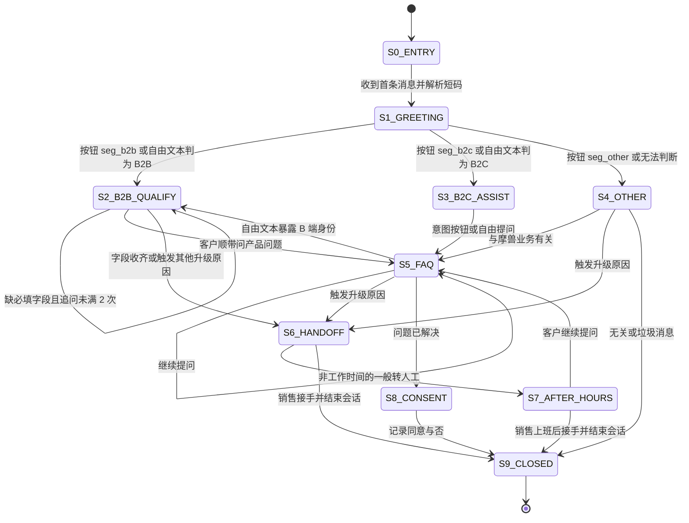

# 对话流程与话术

> 用途：定义 Bot 的状态机、每个状态的触发条件、英文母版话术、按钮文案、分支条件、写入的变量与每条路径的消息条数预算。读者：集成工程师（搭 Flow 与 AI Agent 时照此配置）、客户运营（审话术）。
> 假设：英文为母版；西、德、法、葡为占位，具体语种【待客户确认】；`{privacy_url}`、`{working_hours}`、`{sla_b2b}`、`{sla_general}` 为占位符，默认值见第 5 节，均【待客户确认】；话术里不出现任何参数、价格、质保条款。

## 1. 状态机

升级原因与优先级见 `routing-rules.md` 第 4 节；任何状态下命中升级原因都直接进 `S6_HANDOFF`，图中只画了主要路径。

## 2. 各状态定义

### S0_ENTRY 入口

| 项 | 内容 |
|---|---|
| 触发 | 客户经带短码的 wa.me 链接、Click-to-WhatsApp 广告或直接搜号码发来首条消息 |
| Bot 发出 | 无（本状态不发消息） |
| 处理 | 解析首条消息里的短码，例如 `Hi Tromox! [IG-2609]`；解析规则见 `source-tracking.md` |
| 写入变量 | `source_code`（平台内写入方式【待核实】；集成服务会用同一规则再解析一次，以服务端为准） |
| 分支 | 无条件进入 `S1_GREETING` |

### S1_GREETING 开场问候与分流

| 项 | 内容 |
|---|---|
| 触发 | 首条消息；或会话已结束后客户再次来访 |
| 消息形式 | 一条消息，带三个回复按钮（WhatsApp 限制：最多 3 个按钮，按钮标题不超过 20 个字符） |
| 写入变量 | `segment` |
| 会话级变量复位 | 进入本状态时把 `escalation_flag` 置为 false、`escalation_reason` 置空。Botmaker 的会话变量很可能按联系人长期保留【待核实】；不复位的话，老客户再次来访的第一条消息就会带着上一次的升级标记，再次触发销售通知。线索类字段（公司、类型、国家等）不复位，老客户不用重答 |

英文母版（逐字使用）：

> Welcome to Tromox. I'm the Tromox virtual assistant (AI). I can help with our electric motorcycles, where to buy, dealership enquiries and after-sales support. We use your messages only to handle your enquiry: {privacy_url}. Which best describes you?

| 按钮标题 | 字符数 | 按钮 id | 写入 | 去向 |
|---|---|---|---|---|
| Dealer/Distributor | 18 | `seg_b2b` | `segment` = `B2B` | `S2_B2B_QUALIFY` |
| Rider or Customer | 17 | `seg_b2c` | `segment` = `B2C` | `S3_B2C_ASSIST` |
| Other | 5 | `seg_other` | `segment` = `unknown` | `S4_OTHER` |

分支条件：

1. 客户按了按钮：以按钮为准。
2. 客户不按按钮、直接打字：交给 AI Agent 判 `segment`，按判定结果进入对应状态；判不出来进 `S4_OTHER`。
3. 按钮与后续文字明显矛盾（按了 "Rider or Customer" 却写"我有三家店想做分销"）：以文字为准并调低 `ai_confidence`，规则见 `routing-rules.md` 第 3 节。

这条消息同时完成三件事：表明是 AI 助手、给出隐私告知、完成分流。不要拆成多条。

### S2_B2B_QUALIFY B 端信息收集

| 项 | 内容 |
|---|---|
| 触发 | `segment` = `B2B` |
| 消息形式 | 一条消息问齐四项；之后最多追问 2 次，且只追问缺失的必填项 |
| 必填项 | `b2b_type`；`company` 或 `contact_name` 至少一项；市场（`country_stated`，没有则用号码国家码） |
| 写入变量 | `b2b_type`、`company`、`contact_name`、`role`、`country_stated`、`city_region`、`product_interest`、`volume`、`existing_dealer_relationship`、`ai_summary`、`ai_confidence`、`escalation_flag`、`escalation_reason`、`language` |

英文母版（逐字使用）：

> Thanks for your interest in partnering with Tromox. So our sales team can prepare, please tell me in one message: 1) your company name and country or market, 2) your business type (dealer, distributor, importer, fleet or rental), 3) which models and roughly how many units you are considering, 4) your name and role.

字段收齐后的交接话术（逐字使用）：

> Thank you, {contact_name}. I have passed your details to our sales team. A Tromox sales manager will reply here, on this WhatsApp number, within {sla_b2b}. Our team works {working_hours}. If you would like to add anything, just reply here.

分支条件：

1. 必填项收齐：`escalation_reason` = `b2b_qualified`，发交接话术，进 `S6_HANDOFF`。
2. 追问满 2 次仍缺必填项：同样进 `S6_HANDOFF`，原因记 `low_confidence`，由销售人工补问；不再让 AI 纠缠。
3. 客户问经销价、折扣、独家条款：发价格与质保守卫话术（第 3 节），原因记 `price_negotiation`，进 `S6_HANDOFF`。
4. 客户顺带问产品问题：进 `S5_FAQ` 作答后回到本状态。
5. `{contact_name}` 为空时，交接话术开头改为 "Thank you."。

### S3_B2C_ASSIST C 端接待

| 项 | 内容 |
|---|---|
| 触发 | `segment` = `B2C` |
| 消息形式 | 一条消息，带三个意图按钮；始终接受自由文本 |
| 写入变量 | `b2c_intent` |

英文母版（逐字使用）：

> Happy to help. What would you like to know?

| 按钮标题 | 字符数 | 按钮 id | 写入 | 去向 |
|---|---|---|---|---|
| Buy / Find a dealer | 19 | `intent_buy` | `b2c_intent` = `buy` | `S5_FAQ` |
| Test ride | 9 | `intent_test_ride` | `b2c_intent` = `test_ride` | `S5_FAQ` |
| Support | 7 | `intent_support` | `b2c_intent` = `support` | `S5_FAQ` |

`parts`、`warranty`、`other` 三种意图没有按钮，由 AI Agent 从自由文本判定。

### S4_OTHER 其他

| 项 | 内容 |
|---|---|
| 触发 | 按了 "Other"，或自由文本无法判定 `segment` |
| 写入变量 | `segment`（可能由 `unknown` 改判为 `B2B` 或 `B2C`）、`ai_summary` |

英文母版（逐字使用）：

> No problem. Please tell me briefly what you need and I will point you in the right direction.

分支条件：

1. 说明后判为 B 端：进 `S2_B2B_QUALIFY`；判为 C 端：进 `S5_FAQ`。
2. 媒体、供应商、求职等与销售无关但与摩兽有关的来访：依据知识库给出对应的公开联系方式（内容【待客户确认】），`segment` 保持 `unknown`，随后结束。
3. 与摩兽无关：发话题收口话术（第 3 节）；再次无关则结束会话。

### S5_FAQ 知识库问答

| 项 | 内容 |
|---|---|
| 触发 | C 端提问；B 端顺带提问；"其他"里与摩兽业务有关的问题 |
| 作答依据 | 只按知识库回答；知识库没有的内容不编造 |
| 写入变量 | `product_interest`、`b2c_intent`、`city_region`、`language`、`ai_summary`、`ai_confidence`、`escalation_flag`、`escalation_reason` |

分支条件：

1. 知识库能答：一条消息说清，能合并就不拆条。
2. 知识库答不了、涉及价格谈判或质保承诺：发守卫话术，进 `S6_HANDOFF`。
3. 连续两次没听懂：发"没听懂两次"话术（第 3 节），原因记 `not_understood_twice`，进 `S6_HANDOFF`。
4. 自由文本暴露 B 端身份：转 `S2_B2B_QUALIFY`。
5. 问题已解决且客户无后续：进 `S8_CONSENT`（该步骤是否启用【待客户确认】），否则直接结束。

### S6_HANDOFF 人工接管

| 项 | 内容 |
|---|---|
| 触发 | 任一升级原因命中（`routing-rules.md` 第 4 节） |
| 动作链 | 对该会话停用 AI，建工单，进销售队列，通知销售群，销售在 Botmaker 用公司号接手 |
| 写入变量 | `escalation_flag` = true、`escalation_reason` |

一般转人工话术（B 端字段收齐时用 S2 的交接话术，其余原因用这一条；逐字使用）：

> I'm connecting you with a member of the Tromox team. They will reply here on this number within {sla_general}. Our team works {working_hours}, so replies outside these hours may take a little longer.

接管只发生在公司号上。话术里不出现销售的个人号码、个人 WhatsApp 或其他联系方式。

### S7_AFTER_HOURS 非工作时间

| 项 | 内容 |
|---|---|
| 触发 | 进入 `S6_HANDOFF` 时不在工作时间，且不是 B 端字段收齐的交接（那条话术本身已含工作时间） |
| 动作 | 用本状态话术替换一般转人工话术；工单与通知照常立即发出；AI 继续可答 FAQ |

英文母版（逐字使用）：

> Thanks for your message. Our team is offline right now (working hours: {working_hours}). I've recorded your request and a colleague will reply here within {sla_general}. Meanwhile I can answer questions about our models and where to buy.

投诉、质保争议、法律、安全类升级在非工作时间同样用本话术，但不再邀请继续提问：删去最后一句。

### S8_CONSENT 营销同意（可选步骤）

| 项 | 内容 |
|---|---|
| 触发 | C 端问题已解决；是否启用【待客户确认】 |
| 写入变量 | `consent_marketing` |

英文母版（逐字使用）：

> Would you like to receive Tromox news and offers on WhatsApp? You can unsubscribe at any time.

| 按钮标题 | 字符数 | 按钮 id | 写入 |
|---|---|---|---|
| Yes, keep me posted | 19 | `consent_yes` | `consent_marketing` = true |
| No, thanks | 10 | `consent_no` | `consent_marketing` = false |

未询问或未作答时 `consent_marketing` 保持为空，不得当作同意。

### S9_CLOSED 结束

| 项 | 内容 |
|---|---|
| 触发 | 销售结束会话并选择结束分类；或 AI 会话自然结束、超时无回复 |
| 动作 | 结束分类经事件回调回写线索 `status`（映射见 `routing-rules.md` 第 5 节）；客户再次来访回到 `S1_GREETING` 或直接续接原队列【待核实】 |

## 3. 通用话术

| 场景 | 英文母版（逐字使用） |
|---|---|
| 话题收口 | I can only help with Tromox products, purchasing, dealership and after-sales questions. Is there anything about Tromox I can help you with? |
| 价格与质保守卫 | I can't quote dealer prices or confirm warranty terms in chat. I'll connect you with our team for that. |
| 没听懂两次 | Sorry, I'm not sure I understood. Let me connect you with a colleague. |

## 4. 其他语种占位

AI Agent 自动跟随客户语言作答；下表是固定话术（Flow 里写死的部分）的翻译占位。开场问候在识别出客户语言之前一律用英文：首条消息常常只是预填的英文短语，不能据此判断语言。

| 话术 | ES | DE | FR | PT |
|---|---|---|---|---|
| S1 开场问候与三个按钮 | 待翻译【待客户确认】 | 待翻译【待客户确认】 | 待翻译【待客户确认】 | 待翻译【待客户确认】 |
| S2 一次问齐 | 待翻译【待客户确认】 | 待翻译【待客户确认】 | 待翻译【待客户确认】 | 待翻译【待客户确认】 |
| S2 交接话术 | 待翻译【待客户确认】 | 待翻译【待客户确认】 | 待翻译【待客户确认】 | 待翻译【待客户确认】 |
| S3 C 端接待与三个按钮 | 待翻译【待客户确认】 | 待翻译【待客户确认】 | 待翻译【待客户确认】 | 待翻译【待客户确认】 |
| S4 其他 | 待翻译【待客户确认】 | 待翻译【待客户确认】 | 待翻译【待客户确认】 | 待翻译【待客户确认】 |
| S6 一般转人工 | 待翻译【待客户确认】 | 待翻译【待客户确认】 | 待翻译【待客户确认】 | 待翻译【待客户确认】 |
| S7 非工作时间 | 待翻译【待客户确认】 | 待翻译【待客户确认】 | 待翻译【待客户确认】 | 待翻译【待客户确认】 |
| S8 营销同意与两个按钮 | 待翻译【待客户确认】 | 待翻译【待客户确认】 | 待翻译【待客户确认】 | 待翻译【待客户确认】 |
| 话题收口 | 待翻译【待客户确认】 | 待翻译【待客户确认】 | 待翻译【待客户确认】 | 待翻译【待客户确认】 |
| 价格与质保守卫 | 待翻译【待客户确认】 | 待翻译【待客户确认】 | 待翻译【待客户确认】 | 待翻译【待客户确认】 |
| 没听懂两次 | 待翻译【待客户确认】 | 待翻译【待客户确认】 | 待翻译【待客户确认】 | 待翻译【待客户确认】 |

翻译要求：按钮标题译文同样不得超过 20 个字符；译文由客户当地同事或经销商过一遍，不直接用机器翻译上线。

## 5. 占位符默认值

| 占位符 | 默认值 | 状态 |
|---|---|---|
| `{privacy_url}` | 客户官网隐私政策链接 | 【待客户确认】 |
| `{working_hours}` | Monday to Friday, 09:00-18:00 China time (UTC+8) | 【待客户确认】 |
| `{sla_b2b}` | one business day | 【待客户确认】 |
| `{sla_general}` | one business day | 【待客户确认】 |
| `{contact_name}` | AI 抽取的联系人姓名；为空时省略称呼 | 系统 |

对客户承诺的时限必须不短于销售内部的响应目标（`routing-rules.md` 第 7 节 T1 至 T4）。

## 6. 消息条数预算

2026-10-01 起窗口内每条回复都计费（SOURCES S-M1），条数预算是硬约束。上限取自成本模型中档输入（`03-whatsapp/cost-model-inputs.csv` 的 `ai_msgs_per_conv_b2b` = 8、`ai_msgs_per_conv_b2c` = 5）。

| 路径 | Bot 与 AI 发出的消息 | 目标条数 | 上限 |
|---|---|---|---|
| B 端顺利路径 | 开场 1 + 一次问齐 1 + 追问 0 至 2 + 交接 1 | 3 至 5 | 8 |
| B 端带产品提问 | 上一行 + FAQ 作答 1 至 2 | 4 至 7 | 8 |
| C 端问答 | 开场 1 + 接待 1 + FAQ 作答 1 至 2 + 营销同意 0 至 1 | 3 至 5 | 5 |
| C 端转人工 | 开场 1 + 接待 1 + 守卫或转人工话术 1 | 3 | 5 |
| 其他、无关 | 开场 1 + 其他 1 + 收口或指引 1 | 3 | 4 |

压条数的做法：

1. 一条说清：开场、隐私告知、分流合在一条；B 端四项信息一次问齐。
2. 能用按钮就用按钮：按钮点击不需要 AI 推理，也不会产生追问。
3. 不发"稍等""收到"一类空消息；不把一段答案拆成多条。
4. 交接话术只发一次；销售接手前 AI 不再重复安抚。
5. 超出上限的对话在每周抽查里单独看原因（`00-client/运维手册.md`）。

## 7. 与其他文件的关系

| 内容 | 文件 |
|---|---|
| 判定规则、升级优先级、时限 | `routing-rules.md` |
| 字段与变量名 | `lead-schema.md` |
| AI Agent 的 system prompt | `02-botmaker/ai-agent-system-prompt.md` |
| 在 Botmaker 里怎么搭 | `02-botmaker/setup-guide.md` |
| 再触达模板 | `02-botmaker/templates/` |
| 端到端用例 | `06-acceptance/uat-test-cases.md` |
