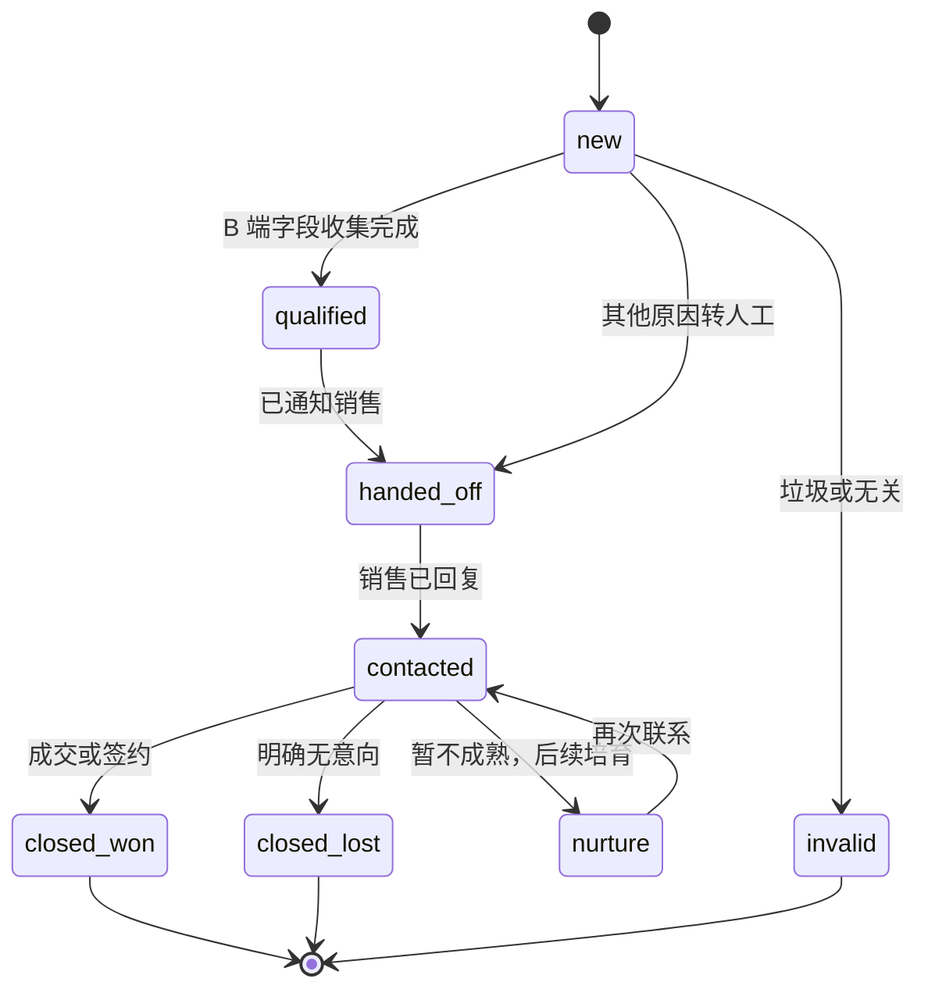

# 线索数据结构（Lead Schema）

> 用途：定义一条线索的全部字段、类型与来源，是字段名的唯一源头。读者：集成工程师。
> 机器可读版本：`shared/tromox_lead/schema.py`（pydantic 模型）与同目录 `lead.schema.json`（JSON Schema，生成物）。本文件中两个 GENERATED 区块由 `scripts/gen_schema_artifacts.py` 注入，**不要手改区块内的内容**：改 `shared/tromox_lead/fields.py` 后重跑脚本。

## 1. 设计要点

1. **一个联系人一条线索**：以 E.164 号码为去重键，`lead_id` 由它哈希生成；同一客户多次来访更新同一条记录，回调重放不会产生重复线索。平台未给出号码时（客户以用户名联系、回调里只有业务范围用户标识【待核实】），改用平台客户 ID 作键（`bm:<customerId>`），`phone` 与 `country_by_phone` 留空，国家改由向客户确认；线索照常入库、照常通知销售，不因为没有号码而丢弃。实现见 `shared/tromox_lead/ids.py`。
2. **每个字段只有一个来源**：按钮、AI 抽取、规则、系统、人工五类。国家由号码国家码按规则判定，B 端或 C 端优先取客户按的按钮，都不让 AI 猜。
3. **AI 只产出 16 个字段**（下表"AI 抽取块"列），以固定 JSON 输出。Botmaker AI Agent 的 system prompt、离线评测的分类 prompt、集成服务的归一化、标注模板的列名，全部使用同一组字段名；根目录 `tests/test_shared_schema.py` 会校验它们一致。
4. **合并规则**：新的抽取结果不会用空值覆盖已有值；`segment` 已是 B2B 或 B2C 时不会被 `unknown` 覆盖。
5. **Botmaker 会话变量与字段同名**（`shared/tromox_lead/fields.py` 中的 `BOTMAKER_VARIABLES`）。若平台不接受下划线变量名【待核实】，集成服务的归一化同时接受驼峰写法（`b2bType` 等）。

## 2. 字段表

<!-- BEGIN GENERATED: lead-fields-table -->
| # | 字段 | 类型 | 来源 | 说明 | AI 抽取块 | 标注列 |
|---|---|---|---|---|---|---|
| 1 | `lead_id` | string | 系统 | 线索主键，由号码哈希生成（同一号码恒定，保证幂等）；平台未给出号码时改用平台客户 ID 哈希 |  |  |
| 2 | `phone` | string (E.164) \| null | 系统 | 客户 WhatsApp 号码，统一为 E.164（如 +4915112345678）；客户以用户名联系、平台只给出业务范围用户 ID 时为空【待核实】 |  | 是 |
| 3 | `country_by_phone` | string (ISO 3166-1 alpha-2) | 规则 | 由号码国家码判定的国家，不让 AI 猜 |  |  |
| 4 | `country_stated` | string (ISO 3166-1 alpha-2) \| null | AI 抽取 | 客户自述的国家/市场；仅对 B 端追问确认 | 是 |  |
| 5 | `language` | string (ISO 639-1) | AI 抽取（规则兜底） | 客户所用语言：AI 每次给出新的确定值就更新（und 不覆盖）；规则兜底只看客户自己写的消息，预填句与问候不定语言 | 是 | 是 |
| 6 | `contact_name` | string \| null | AI 抽取 | 联系人姓名（AI 从对话里抽取；WhatsApp 资料名不写入此字段） | 是 |  |
| 7 | `profile_name` | string \| null | 系统 | WhatsApp 资料名（firstName + lastName），只作显示兜底，不参与合格判定 |  |  |
| 8 | `company` | string \| null | AI 抽取 | 公司/门店名称 | 是 |  |
| 9 | `role` | string \| null | AI 抽取 | 职位或身份（如 owner、purchasing manager） | 是 |  |
| 10 | `segment` | enum: B2B \| B2C \| unknown | 按钮（自由文本时 AI 抽取） | B 端 / C 端 / 未知 | 是 | 是 |
| 11 | `b2b_type` | enum: dealer \| distributor \| fleet \| importer \| other \| null | AI 抽取 | B 端类型；非 B 端为 null | 是 | 是 |
| 12 | `b2c_intent` | enum: buy \| support \| parts \| warranty \| test_ride \| other \| null | AI 抽取 | C 端意图；非 C 端为 null | 是 | 是 |
| 13 | `product_interest` | string[]（产品代码） | AI 抽取 | 感兴趣的车型代码，按产品目录归一化 | 是 | 是 |
| 14 | `volume` | string \| null | AI 抽取 | 意向数量/频次的原话摘要（如 "20 units / quarter"） | 是 |  |
| 15 | `city_region` | string \| null | AI 抽取 | 城市或地区 | 是 |  |
| 16 | `existing_dealer_relationship` | string \| null | AI 抽取 | 现有经销关系简述（已代理品牌、是否已是摩兽经销商等） | 是 |  |
| 17 | `source_channel` | enum: instagram \| facebook \| tiktok \| youtube \| website \| ctwa_ad \| offline_qr \| other \| unknown | 规则 | 来源渠道，由短码前缀或广告 referral 判定 |  |  |
| 18 | `source_code` | string \| null | 规则 | 首条消息中的来源短码（如 IG-2609） |  |  |
| 19 | `referral` | object \| null | 系统 | Click-to-WhatsApp 广告 referral（source_id、source_url、headline 等）；是否透传【待核实】 |  |  |
| 20 | `first_message_ts` | datetime (UTC, ISO 8601) | 系统 | 首条消息时间 |  |  |
| 21 | `last_message_ts` | datetime (UTC, ISO 8601) | 系统 | 客户最后一条消息时间；24 小时客服窗口以此起算 |  |  |
| 22 | `ai_summary` | string | AI 抽取 | 给销售看的一两句话摘要（默认简体中文【待客户确认】） | 是 |  |
| 23 | `ai_confidence` | number 0-1 | AI 抽取 | 模型对 segment 判断的自评置信度；低于 0.6 触发人工 | 是 |  |
| 24 | `escalation_flag` | boolean | AI 抽取 + 规则 | 是否需要人工接管 | 是 | 是 |
| 25 | `escalation_reason` | enum: human_requested \| b2b_qualified \| low_confidence \| complaint_warranty_legal_safety \| price_negotiation \| not_understood_twice \| null | AI 抽取 + 规则 | 接管原因 | 是 | 是 |
| 26 | `assigned_to` | string \| null | 系统 | 接手的销售/坐席（来自 Botmaker 分配事件） |  |  |
| 27 | `status` | enum: new \| qualified \| handed_off \| contacted \| closed_won \| closed_lost \| nurture \| invalid | 系统 + 人工 | 线索状态；销售结束会话时回写 |  |  |
| 28 | `tags` | string[] | 规则 | 按 tag-taxonomy.md 由字段生成的标签 |  |  |
| 29 | `consent_marketing` | boolean \| null | 按钮 | 是否同意接收营销类消息；未询问为 null |  |  |
| 30 | `notes` | string \| null | 人工 | 销售备注 |  |  |
<!-- END GENERATED: lead-fields-table -->

## 3. AI 抽取块（固定 JSON）

下面的 JSON 块会被逐字写进两个 prompt（`02-botmaker/ai-agent-system-prompt.md` 与 `04-eval/prompts/classify-v1.md`）。

<!-- BEGIN GENERATED: extraction-json -->
```json
{
  "language": "<ISO 639-1 code of the customer's language, e.g. en, es, de, fr, pt, it>",
  "segment": "B2B | B2C | unknown",
  "b2b_type": "dealer | distributor | fleet | importer | other | null",
  "b2c_intent": "buy | support | parts | warranty | test_ride | other | null",
  "country_stated": "<ISO 3166-1 alpha-2 ONLY if the customer states their country/market, else null>",
  "city_region": "<string or null>",
  "contact_name": "<string or null>",
  "company": "<string or null>",
  "role": "<string or null>",
  "product_interest": [
    "<zero or more of: MC10, UKKO, M05, MINO, M03, PESGO>"
  ],
  "volume": "<short quote of stated quantity/frequency, or null>",
  "existing_dealer_relationship": "<short text or null>",
  "ai_summary": "<1-2 sentences for the sales team, in Simplified Chinese>",
  "ai_confidence": "<number between 0 and 1 for the segment decision>",
  "escalation_flag": "true | false",
  "escalation_reason": "human_requested | b2b_qualified | low_confidence | complaint_warranty_legal_safety | price_negotiation | not_understood_twice | null"
}
```
<!-- END GENERATED: extraction-json -->

## 4. 枚举取值

| 字段 | 取值 | 说明 |
|---|---|---|
| `segment` | `B2B` / `B2C` / `unknown` | `unknown` 含纯问候、垃圾消息、求职、供应商推销、媒体合作等 |
| `b2b_type` | `dealer` / `distributor` / `fleet` / `importer` / `other` | 定义见 `shared/prompt_blocks/extraction-rules.md` 第 2 条 |
| `b2c_intent` | `buy` / `support` / `parts` / `warranty` / `test_ride` / `other` | 同上第 3 条 |
| `escalation_reason` | `human_requested` / `b2b_qualified` / `low_confidence` / `complaint_warranty_legal_safety` / `price_negotiation` / `not_understood_twice` | 触发条件见 `routing-rules.md` |
| `status` | `new` / `qualified` / `handed_off` / `contacted` / `closed_won` / `closed_lost` / `nurture` / `invalid` | 流转见第 5 节 |
| `source_channel` | `instagram` / `facebook` / `tiktok` / `youtube` / `website` / `ctwa_ad` / `offline_qr` / `other` / `unknown` | 由短码前缀判定，见 `source-tracking.md` |

产品代码目录：`MC10`、`UKKO`、`M05`、`MINO`、`M03`、`PESGO`（来自官网公开车型名，SOURCES 第 4 节）。现售清单【待客户确认】。

## 5. 状态流转



销售结束会话时在 Botmaker 选择结束分类（typification），集成服务据此回写 `status`；映射表见 `05-integration/botmaker-api-notes.md`。【待核实】

## 6. 标注模板列与本结构的关系

`04-eval/labeling-template.csv` 的列分两类：

| 类别 | 列 | 说明 |
|---|---|---|
| 与本结构同名 | `phone`、`language`、`segment`、`b2b_type`、`b2c_intent`、`product_interest`、`escalation_flag`、`escalation_reason` | 列名与字段名逐字相同 |
| 仅标注用 | `sample_id`、`data_origin`、`conversation_text`、`country_gold`、`is_valid_lead`、`annotator`、`label_notes` | `country_gold` 是标注员确认的真实国家，用于核对"自述国家优先、号码国家码兜底"这条规则的准确率 |

## 7. 隐私

- 线索库只存业务所需字段；不存完整聊天记录（聊天记录留在 Botmaker）。
- 发到销售群的通知默认对号码打码，只留后四位，详情点链接回 Botmaker 看。
- 删除请求：按 `phone` 删除线索记录，流程见 `03-whatsapp/compliance.md`。
