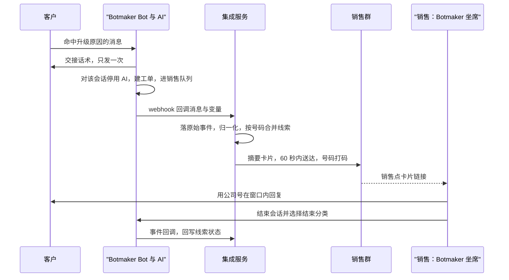

# 路由与判定规则

> 用途：国家、语言、B 端或 C 端的判定规则，升级与人工接管规则，工作时间与夜间策略，24 小时窗口逻辑与响应时限。读者：集成工程师；销售主管与客户运营读第 5 至 8 节。
> 机器实现：`shared/tromox_lead/`（`country.py`、`language.py`、`routing.py`、`enums.py`）。离线评测与集成服务调用同一份代码，所以这里写的就是生产行为。
> 假设：工作时间、响应时限、结束分类名称均为默认值，【待客户确认】。

## 1. 国家判定：不让 AI 猜

| 步骤 | 规则 | 实现 |
|---|---|---|
| 1 | 把 WhatsApp 传来的号码统一成 E.164（如 `+4915112345678`）；Botmaker 回调里的号码不带加号，先补上再解析 | `normalize_e164` |
| 2 | 用 phonenumbers 库按号段判定国家，得到 `country_by_phone`（ISO 3166-1 alpha-2） | `country_from_phone` |
| 3 | 号段无法定位到具体地区时，退回该国家码的主要国家 | 同上 |
| 4 | 客户明确说出国家或全国性市场时，AI 才填 `country_stated`；只说城市则写进 `city_region`，`country_stated` 留空 | 抽取规则第 4 条 |
| 5 | 对外使用的国家 = `country_stated`，没有则取 `country_by_phone` | `effective_country` |

只对 B 端线索追问确认国家：确认动作已经包含在 B 端"一次问齐"话术的第 1 项里，不另发消息。C 端直接采用号码国家码。

多地区共用的国家码（`AMBIGUOUS_CALLING_CODES`）：

| 国家码 | 覆盖 |
|---|---|
| +1 | 美国、加拿大及加勒比多国 |
| +7 | 俄罗斯、哈萨克斯坦 |
| +44 | 英国、根西、泽西、马恩岛 |
| +47 | 挪威、斯瓦尔巴 |
| +61 | 澳大利亚、圣诞岛、科科斯群岛 |
| +212 | 摩洛哥、西撒哈拉 |
| +262 | 留尼汪、马约特 |
| +358 | 芬兰、奥兰 |
| +590 | 瓜德罗普、圣巴泰勒米、法属圣马丁 |
| +599 | 库拉索、荷属加勒比 |

号码有效时 phonenumbers 通常能按号段分清；这张表是保守标记，用于提醒销售"号码国家仅供参考"。

已知偏差：漫游、外籍人士、虚拟号码会让号码国家与实际市场不一致。B 端靠自述国家纠正；C 端接受这一误差，验收指标只统计有号码前缀的样本（`06-acceptance/acceptance-criteria.md` A3）。

## 2. 语言判定

| 步骤 | 规则 |
|---|---|
| 1 | 首条消息常常只是预填的英文短语（`Hi Tromox! [IG-2609]`），不能据此判断语言；开场问候一律用英文 |
| 2 | 以客户第一条自己写的内容为准，由 AI 抽取 `language`（ISO 639-1） |
| 3 | 变量缺失时，集成服务用规则检测器兜底（`detect_language`）：只在线索的 `language` 仍是 `und` 时运行，取本次回调里客户的第一条消息，先去掉短码，再去掉问候语与品牌词（`hi`、`hello`、`hey`、`hola`、`hallo`、`bonjour`、`olá`、`ola`、`ciao`、`buongiorno`、`tromox`），按停用词打分；剩下没有可打分的词或输入过短返回 `und`，等客户下一条自己写的消息再测。预填句与纯问候因此不会定语言 |
| 4 | 回复语言：客户语言在支持清单内（`SUPPORTED_LANGUAGES`：en、es、de、fr、pt、it，最终清单【待客户确认】）则跟随；不在清单内用英文作答，并在需要时转人工 |
| 5 | 客户中途换语言，AI 跟着换；`language` 记最新值：AI 每次给出新的确定值就更新（最新值对回复客户的销售更有用），`und` 与空值不覆盖已有值。AI 给的 `en-US`、`pt_BR` 只取主子标签（`en`、`pt`）；主子标签不是正好两个字母的值（如全称 `German`、单个字母）按 `und` 处理，不截断（`AIExtraction`） |

## 3. B 端或 C 端判定

1. **按钮优先**：客户在开场按了按钮，`segment` 直接取按钮值，置信度视为 0.9 以上。
2. **自由文本**：客户不按按钮直接打字，由 AI 按抽取规则第 1 条判定。
3. **矛盾规则**：按钮与文字明显矛盾时以文字为准，并调低 `ai_confidence`。典型例子：按了 "Rider or Customer"，却写"我有三家店，想做分销"。
4. **代价不对称**：漏掉一个真经销商，远比把一个个人客户误送给销售严重。B 端与 C 端确实分不清时判 `B2B`，并把 `ai_confidence` 设到 0.6 以下，让规则层把它送到人工。验收主指标是 B 端召回率，原因在此。
5. **unknown**：纯问候、垃圾消息、求职、向摩兽推销的供应商、媒体与达人合作、与摩兽无关的内容。
6. `segment` 一旦是 `B2B` 或 `B2C`，后续不会被 `unknown` 覆盖（`Lead.apply_extraction`）。

## 4. 升级与人工接管触发

### 4.1 模型层：按顺序取第一个命中的原因

顺序与 `shared/prompt_blocks/extraction-rules.md` 第 7 条逐项一致。

| 优先级 | `escalation_reason` | 触发条件 | 对应任务书的触发项 |
|---|---|---|---|
| 1 | `complaint_warranty_legal_safety` | 投诉、事故、受伤、电池起火或冒烟、法律威胁、退款纠纷、质保索赔或争议、个人数据请求 | 投诉、质保、法律、安全 |
| 2 | `human_requested` | 明确要求真人、客服、销售或电话 | 明确要求真人 |
| 3 | `price_negotiation` | 要折扣、经销价或批发价、报价单、付款或独家条款 | 价格谈判 |
| 4 | `not_understood_twice` | AI 连续两条客户消息没听懂（仅对话模式） | 连续两次听不懂 |
| 5 | `low_confidence` | `ai_confidence` 低于 0.6；拿不准的线索即使字段齐了，也要以"拿不准"的名义交给人 | 置信度低 |
| 6 | `b2b_qualified` | `segment` = `B2B`，且类型、对象（公司或联系人）、市场三项齐备 | B 端字段收集完成 |

都不命中：`escalation_flag` = false，`escalation_reason` 为空。

### 4.2 规则层：只补判，不撤销

实现：`apply_routing_rules`。模型可能漏标，规则层在模型输出之上再过一遍：

1. 模型已给出升级标记和原因：原样保留，规则层不改。
2. 模型没给原因，且 `ai_confidence` 低于 `LOW_CONFIDENCE_THRESHOLD`（0.6）：补 `low_confidence`。
3. 否则，若满足 B 端字段齐备（`is_b2b_qualified`：`segment` = `B2B`，有 `b2b_type`，有 `company` 或 `contact_name`（都指 AI 从对话里抽取的值；WhatsApp 资料名只存 `profile_name`、只作显示兜底，不算「有联系人」），有 `country_stated` 或 `country_by_phone`）：补 `b2b_qualified`。
4. 模型标了升级却没给原因：补 `low_confidence`。
5. 规则层只会增加升级，永远不会取消模型给出的升级。

说明：规则层补判的先后（先看置信度、再看字段齐备）与模型层第 5、6 项一致。两者的结果都是转人工，差别只在通知卡片上显示的原因；这是有意的保守取向：置信度低的线索即使字段齐了，也提醒销售"AI 拿不准"。

### 4.3 质保问题的分界

| 情形 | 处理 |
|---|---|
| 一般性询问质保政策，且知识库有明确、允许对外的表述 | 按知识库回答，`b2c_intent` = `warranty`，不升级 |
| 一般性询问，但知识库没有对应内容 | 发价格与质保守卫话术，转人工 |
| 质保索赔、争议、要求承诺超出知识库的条款 | 升级，原因 `complaint_warranty_legal_safety` |

AI 不报经销价、不承诺质保条款，除非知识库明确允许。

## 5. 人工接管链路

| 环节 | 规则 |
|---|---|
| 停用 AI | 转人工后对该会话静音 Bot，避免 AI 与销售同时回复；会话结束后恢复。平台内的具体动作名称【待核实】；API 侧聊天对象带 `isBotMuted` 字段（SOURCES S-B2） |
| 建工单 | 工单标题含国家、类型、公司；正文为 `ai_summary` 与字段清单 |
| 队列 | MVP 设一个销售队列；按语种或区域分队列放到调优期再定【待客户确认】 |
| 通知 | 同一线索、同一原因、同一会话只通知一次；坐席发起、没有客户消息的回调（如窗口关闭后销售发模板）不通知；线索已交接（`handed_off` / `contacted`）后，`b2b_qualified` 的重判不再通知，其他原因照常；号码默认只显示后四位 |
| 接手 | 只在 Botmaker 坐席界面、用公司号接手；**绝不**把客户引到销售个人的 WhatsApp 或手机 |
| 回写 | 销售结束会话时选择结束分类，集成服务据此更新 `status` |

结束分类与线索状态的映射（分类名称【待核实】【待客户确认】）：

| 结束分类 | `status` |
|---|---|
| `qualified_followup` | `contacted` |
| `won` | `closed_won` |
| `lost` | `closed_lost` |
| `nurture` | `nurture` |
| `not_a_lead` | `invalid` |

## 6. 工作时间与夜间策略

默认工作时间：周一至周五 09:00 至 18:00，北京时间（UTC+8）【待客户确认】。

| 客户所在地的白天 09:00 至 18:00 | 对应北京时间（冬令时） | 对应北京时间（夏令时） | 与默认工作时间的重叠 |
|---|---|---|---|
| 中欧（德、法、意、西） | 16:00 至次日 01:00 | 15:00 至 24:00 | 2 至 3 小时 |
| 英国 | 17:00 至次日 02:00 | 16:00 至次日 01:00 | 1 至 2 小时 |
| 美国东部 | 22:00 至次日 07:00 | 21:00 至次日 06:00 | 无 |
| 美国西部 | 次日 01:00 至 10:00 | 次日 00:00 至 09:00 | 约 1 小时 |

上线日（`07-project/timeline.md`）在欧美切换冬令时之后，按冬令时一列执行。

结论：欧美询盘大多在国内夜间进来。策略：

1. AI 全天在线，先接住：分流、答 FAQ、收 B 端字段，不让客户空等。
2. 需要人工时明确告知跟进时限：B 端字段收齐用 S2 交接话术（本身含工作时间）；其余原因在非工作时间用 S7 话术。
3. 通知照常立即发到销售群，不攒到早上；销售上班先处理夜间积压，按窗口剩余时间从少到多排序。
4. 周五晚到周日的进线最容易过窗口，见第 7 节 T4。

## 7. 24 小时窗口与响应时限

窗口规则：客户最后一条消息之后 24 小时内可以自由回复；窗口关闭后只能发经 Meta 预审的模板消息。窗口截止时间 = `last_message_ts` + 24 小时；Botmaker 的聊天对象直接给出 `whatsAppWindowCloseDatetime`（SOURCES S-B2），通知卡片上以北京时间显示截止时间。客户每回复一次，窗口重新计 24 小时。经 Click-to-WhatsApp 广告进入的会话另有 72 小时的免费计费窗口，但能否自由回复仍看 24 小时窗口（细节【待核实】）。

响应时限（全部【待客户确认】）：

| 编号 | 场景 | 时限 |
|---|---|---|
| T1 | 工作时间内进线的 B 端线索 | 首次人工回复不超过 2 小时 |
| T2 | 非工作时间进线 | 下一个工作日北京时间 10:00 前回复 |
| T3 | 硬规则 | 客户最后一条消息后 24 小时内至少回复一次，否则只能发模板 |
| T4 | 周末与节假日 | 建议 B 端线索安排值班，每天至少查看一次；不值班则下一个工作日用模板再触达 |
| T5 | 系统 | B 端线索确认到销售群收到通知不超过 60 秒 |

对客户话术里的 `{sla_b2b}`、`{sla_general}` 不得短于 T1、T2 实际能做到的水平。

可选增强（未纳入 MVP 脚手架，调优期视销售响应数据决定是否加）：已交接但销售尚未回复的线索，在窗口剩余 4 小时时向销售群补发一次提醒。

## 8. 窗口关闭后用哪条模板

模板属 utility 类，措辞不带促销内容；Meta 可能改判为 marketing 类【待核实】。模板正文见 `02-botmaker/templates/`。

| 模板 | 什么时候用 | 精简版 | 完整版 |
|---|---|---|---|
| `tromox_sales_followup_v1` | B 端线索已交接，但销售首次回复前窗口已关闭（夜间、周末最常见） | 含 | 含 |
| `tromox_info_request_v1` | B 端信息未收齐、客户中途离开，窗口已关闭，需要补问缺失项 | 含 | 含 |
| `tromox_support_update_v1` | C 端售后或质保个案有进展要告知，窗口已关闭 | 不含 | 含 |

使用约束：

1. 只发给先联系过我们的客户；不向导入的名单或从未来过的号码发送。
2. 同一客户同一咨询，模板最多发 2 次，间隔不少于 3 天；两次都没回就把线索状态记为 `nurture` 或 `closed_lost`，不再追发【待客户确认】。（与 `02-botmaker/templates/README.md` 同一口径。）
3. 客户回复模板后窗口重新打开，销售转回自由回复。
4. 被大量拉黑或举报会拉低号码质量评级，见 `03-whatsapp/meta-onboarding-checklist.md`。
