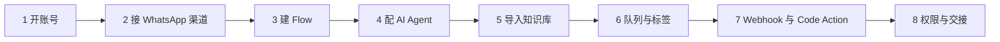

# Botmaker 配置指南

> 用途：从零到可上线，分步配置 Botmaker；每一步都带"验证方法"，做完即可自检。读者：集成工程师；客户运营在培训后可对照第 5、6 步做日常维护。
> 假设：账号、号码、Meta 商务账户全部开在客户名下，集成工程师只持有 Botmaker 后台的操作席位（Meta 侧默认不需要管理员权限，见 `03-whatsapp/meta-onboarding-checklist.md` 第 2 节第 6 项）；后台界面以英文为准；界面路径只写已在帮助中心读到的（见 `SOURCES.md`），其余一律写成"在 Botmaker 后台的 X 功能中"并标【待核实】，首次进入试用账号时补全。
> 前置：客户已按 `03-whatsapp/meta-onboarding-checklist.md` 准备好 Meta 商务账户与号码；操作人所在网络可稳定访问 Botmaker 后台（SOURCES S-B15）【待核实】。

## 0. 总览



| 步骤 | 产出 | 预计用时 | 依赖 |
|---|---|---|---|
| 1 开账号 | 客户名下的 Botmaker 账号 | 0.5 小时 | 客户提供企业邮箱 |
| 2 接 WhatsApp 渠道 | 号码在 Botmaker 中为已连接状态；Central 转接已关闭 | 1 至 2 小时，另加 Meta 审核的日历时间 | Meta 商务账户管理员在场 |
| 3 建 Flow | 开场、按钮分流、转人工、夜间提示可走通 | 1 天 | `01-design/conversation-flow.md` |
| 4 配 AI Agent | 限定用途的 AI Agent 挂到 Flow 上 | 0.5 天 | `ai-agent-system-prompt.md` |
| 5 导入知识库 | 首版 FAQ 可被 AI 引用 | 0.5 天 | 客户填好的 `knowledge-base-template.md` |
| 6 队列与标签 | 销售队列、工单、标签、结束分类就绪 | 0.5 天 | `01-design/tag-taxonomy.md` |
| 7 Webhook 与 Code Action | 回调打到集成服务；路线 B 时外部分类可调用 | 0.5 天 | `05-integration/` 已部署 |
| 8 权限与交接 | 客户为所有者，各角色权限到位 | 0.5 小时 | 人员名单【待客户确认】 |

开工第 1 周先在试用账号里跑 `trial-test-plan.md`，其结论决定第 4、7 步走路线 A 还是路线 B（`01-design/adr/0003-ai-route-a-b.md`）。

## 1. 开账号

1. 由客户用企业邮箱注册 Botmaker 账号（开账号免费，附最多 300 个初始对话额度，SOURCES S-B3）。注册邮箱用公共邮箱（如 `whatsapp-admin@客户域名`）而不是个人邮箱，避免人员变动后账号失联。【待客户确认】
2. 客户把集成工程师加为管理员（见第 8 步）。集成工程师不代客户注册，不使用自己的邮箱作为所有者。
3. 套餐先不付费，试用期验证完（`trial-test-plan.md`）再由客户绑卡开 Standard（149 USD/月，按 DAILY USER 计数，SOURCES S-B3）。开通 WhatsApp 商业平台账户另有一次性 99 USD。超出套餐的单价两页不一致：定价页写 Standard 每个额外对话 0.07 USD，FAQ 写 0.025 USD【待核实】（SOURCES S-B3）。合同主体为 BOTMAKER INC 或其阿根廷、巴西关联公司；非拉美主体能否开票、发票抬头与税务处理【待核实】（SOURCES S-B14）。
4. 账号内的时区、语言等全局设置：在 Botmaker 后台的账号设置功能中完成【待核实】；号码的时区在第 2 步接入时填写（SOURCES S-B4）。后台界面语言只有英、西、葡、法四种，没有中文（SOURCES S-B14），统一用英文。
5. Meta 消息费的支付方式：Meta 要求 2026-09-30 前绑定支付方式，否则 10/1 起用完每号码每月 1,000 条免费额度后，服务消息停投（SOURCES S-M9、S-M3）。经 Botmaker 接入时是由 Botmaker 结算，还是要客户在 WhatsApp 商业账户上自绑【待核实】：接入号码（第 2 步）前由客户向 Botmaker 书面确认，答复存档。

**验证方法**：客户管理员与集成工程师都能登录同一个项目；在 Botmaker 后台的成员管理功能中【待核实】能看到客户邮箱为所有者。截图存入交付记录（验收项 C5）。

## 2. 接 WhatsApp 渠道

两条官方路径二选一，决策依据见 `01-design/adr/0002-number-strategy.md`；MVP 默认推荐路径 a。

| | 路径 a：公司名下新办专用号 | 路径 b：现有 WhatsApp Business App 号走 Coexistence |
|---|---|---|
| 适用 | 社媒上还没有公开过固定的 WhatsApp 号，或不想让机器人碰到老客户会话 | 现有号码已印在社媒主页、老客户都在这个号上 |
| 历史会话 | 无 | 可同步近 6 个月（SOURCES S-B4、S-M6） |
| 销售能否继续用手机 App | 不能，统一在 Botmaker 坐席界面回复 | 能；手机 App 发的消息免费，经平台发的按条计费（SOURCES S-M6） |
| 额外约束 | 号码需能收短信或语音验证码，且当前未注册在任何 WhatsApp 上 | App 版本不低于 2.24.17；至少每 14 天打开一次 App，否则断连；Meta 另写伴侣设备约 30 天不活跃也会断连，所指范围【待核实】（SOURCES S-M6）；吞吐固定 20 条/秒；阅后即焚、一次性查看、实时位置、广播列表停用；国家限制已全部取消，仅中国大陆 +86 号码没有官方原文点名，以接入流程实测为准【待核实】（SOURCES S-M7） |

### 2a. 新号接入

1. 进入 Settings > Channels > WhatsApp，点 "Add WhatsApp account"（SOURCES S-B4）。
2. 由**客户的 Meta 商务账户管理员**用其 Facebook 账号登录，选择客户自己的 Business Portfolio，新建 WhatsApp Business 账户。不要勾选 "Connect with a WhatsApp Business app"。
3. 填显示名（规则见 `03-whatsapp/meta-onboarding-checklist.md` 第 5 节）、类别、号码；接收验证码完成验证。
4. 回到 Botmaker 选择刚接入的号码，填账户名与时区（SOURCES S-B4）。
5. 设置两步验证 PIN 并交客户保管：在 Botmaker 或 Meta 后台的号码设置功能中【待核实】。

### 2b. Coexistence 接入

1. 先确认手机上的 WhatsApp Business App 版本不低于 2.24.17（SOURCES S-M6），并备份聊天记录。
2. 进入 Settings > Channels > WhatsApp，点 "Add WhatsApp account"，用客户管理员的 Facebook 账号登录并选择客户的 Business Portfolio。
3. **勾选 "Connect with a WhatsApp Business app"**，输入现用号码（SOURCES S-B4）。
4. 持有该手机的人在场：App 会收到提示，扫描屏幕上的二维码并按手机的安全验证授权；确认共享近 6 个月的联系人与聊天。
5. 回到 Botmaker 确认连接，选择该号码，填账户名与时区。接入后 24 小时内要完成历史同步，未完成须断开重走（SOURCES S-M6）。
6. 与销售约定分工：哪些会话由机器人先接、哪些由人在手机上直接回。人从手机 App 回复后机器人是否自动静默【待核实】，在试用账号验证（`trial-test-plan.md` 的 T-1）。
7. 安排专人至少每 14 天打开一次该 App（建议每周一次，写进 `00-client/运维手册.md` 的周检项）。
8. 并存号码不能用 API 注销：要断开由客户在 App 的 Settings > Account > Business Platform 里操作，断开后 15 分钟才能重新接入（SOURCES S-M6）。

**验证方法（两条路径通用）**：

1. Botmaker 的 WhatsApp 渠道页显示号码为已连接；调用 `GET /whatsapp/accounts/{number}/status`（SOURCES S-B2）返回正常状态与质量评级。上线前由工程师用客户生成的 token 执行，不在本仓库脚本里调用。
2. 用另一部手机给该号码发 "Hi Tromox! [OT-2610]"，Botmaker 会话列表里出现该会话。
3. 路径 b 追加：从手机 App 回一条消息，确认 Botmaker 会话里能看到这条人工消息；确认 App 内老会话仍在。

### 2c. 关闭 WhatsApp→Central 转接（两条路径都要做）

Botmaker 自 2026-10-01 起在每条 WhatsApp 线路上默认开启"WhatsApp→Central 转接"：开着时机器人不在 WhatsApp 上回复，客户只会收到一条带按钮的邀请消息，被引到 Botmaker 自家的 Central 网页聊天继续对话（SOURCES S-B16）。MVP 要在 WhatsApp 上接待、由销售用公司号接手，必须关掉。

1. 号码接入后、第 3 步搭流程之前，进入该线路的 Settings，取消勾选 WhatsApp→Central 转接，**保存后才生效**。
2. 它按线路开关：每条线路都要单独关一次，以后新接入或重新接入的号码也一样。
3. 2026-10-01 之前接入的线路，10/1 之后再复查一次开关状态。

**验证方法**：用另一部手机给该号码发一条消息，收到的不是带按钮的 Central 邀请消息；第 3 步搭好流程后，收到的是机器人的开场消息。线路设置页截图存入交付记录。

## 3. 建 Flow

话术与状态机的唯一源头是 `01-design/conversation-flow.md`，分支条件见 `01-design/routing-rules.md`；这里只写在 Botmaker 里怎么搭。原则：**能用按钮就不让 AI 猜；一条消息说清，少来回**（每条窗口内消息都计费，见 `03-whatsapp/cost-model.md`）。

### 3.1 先建会话变量

在 Botmaker 后台的变量管理功能中【待核实】建下列 18 个会话变量，**变量名与线索字段名逐字相同**（源头：`shared/tromox_lead/fields.py` 的 `BOTMAKER_VARIABLES`）。变量 ID 不能含空格、连字符、星号等特殊字符（SOURCES S-B18）；是否允许下划线、是否区分大小写、长度上限原文未写【待核实】，由 `trial-test-plan.md` 的 T-9 实测，实测前不改名。平台若不接受下划线，改用驼峰（如 `b2bType`），集成服务的归一化两种写法都接受；但这会牵动全仓以下划线命名的字段名（本表、`ai-agent-system-prompt.md` 的写变量指令、7.2 的 `FIELDS`、6.3 的标签字符串、`shared/tromox_lead/fields.py` 等），须统一改，不能只改平台一侧。自定义变量还要避开预定义变量（驼峰命名、不可删除）与 Google Ads 集成自动写入的 `sourceId`、`gclid`（SOURCES S-B18）。

| # | 变量名 | 类型与取值 | 由谁写入 |
|---|---|---|---|
| 1 | `language` | ISO 639-1，如 `en`、`es`、`de` | AI Agent（集成服务有规则兜底） |
| 2 | `segment` | `B2B` / `B2C` / `unknown` | 开场按钮；客户不按按钮直接打字时由 AI Agent |
| 3 | `b2b_type` | `dealer` / `distributor` / `fleet` / `importer` / `other` | AI Agent |
| 4 | `b2c_intent` | `buy` / `support` / `parts` / `warranty` / `test_ride` / `other` | C 端按钮或 AI Agent |
| 5 | `country_stated` | ISO 3166-1 alpha-2；客户没明说国家则留空 | AI Agent |
| 6 | `city_region` | 文本 | AI Agent |
| 7 | `contact_name` | 文本 | AI Agent |
| 8 | `company` | 文本 | AI Agent |
| 9 | `role` | 文本 | AI Agent |
| 10 | `product_interest` | 产品代码，多个用分号分隔，如 `MC10;UKKO` | AI Agent |
| 11 | `volume` | 客户原话的简短摘录 | AI Agent |
| 12 | `existing_dealer_relationship` | 简短文本 | AI Agent |
| 13 | `ai_summary` | 一两句简体中文摘要，给销售看 | AI Agent |
| 14 | `ai_confidence` | 0 到 1 的小数 | AI Agent |
| 15 | `escalation_flag` | `true` / `false` | AI Agent 与转人工节点 |
| 16 | `escalation_reason` | `human_requested` / `b2b_qualified` / `low_confidence` / `complaint_warranty_legal_safety` / `price_negotiation` / `not_understood_twice` | AI Agent 与转人工节点 |
| 17 | `consent_marketing` | `true` / `false`；没问过则留空 | S8 同意按钮 |
| 18 | `source_code` | 来源短码，如 `IG-2609` | 可不在 Botmaker 内解析：集成服务会从首条消息里解析（`01-design/source-tracking.md`） |

国家码判定的国家（`country_by_phone`）不设变量：由集成服务按号码前缀计算，不让 AI 猜。

### 3.2 状态与节点对照

| 状态 | 在 Botmaker 里怎么搭 | 要点 |
|---|---|---|
| S0_ENTRY | 默认入口：任何首条消息都进入 S1 | 首条消息形如 `Hi Tromox! [IG-2609]`，不要因为带方括号短码而走"听不懂" |
| S1_GREETING | 一条带 3 个回复按钮的消息 | 按钮标题不超过 20 个字符，最多 3 个：`Dealer/Distributor`、`Rider or Customer`、`Other`；话术含 AI 身份告知与隐私政策链接 `{privacy_url}`【待客户确认】；**进入本状态先把变量 `escalation_flag` 置为 false、`escalation_reason` 置空**（会话变量很可能按联系人长期保留【待核实】，不复位会让老客户再次来访时重复通知销售） |
| S2_B2B_QUALIFY | 按钮动作写 `segment=B2B`，随后一条"一次问清"的消息，再交给 AI Agent | 之后最多追问 2 次，只补必填项（B 端类型；公司或联系人；市场），齐了就转 S6 |
| S3_B2C_ASSIST | 按钮动作写 `segment=B2C`，随后一条带 3 个按钮的消息：`Buy / Find a dealer`、`Test ride`、`Support` | 按钮分别写 `b2c_intent=buy` / `test_ride` / `support`；客户直接打字也接受 |
| S4_OTHER | 按钮动作写 `segment=unknown`，一条引导语后交给 AI Agent | AI 判断后可改写 `segment` |
| S5_FAQ | AI Agent + 知识库 | 只按知识库回答；不报经销价，不承诺知识库以外的质保条款 |
| S6_HANDOFF | 转人工节点：写 `escalation_flag=true` 与原因 → 静默机器人 → 转入队列 → 建工单 → 发交接话术 | 顺序与话术见 3.3；接管始终发生在公司号上 |
| S7_AFTER_HOURS | 工作时间判断：在 Botmaker 后台的营业时间功能中【待核实】配置 `{working_hours}`【待客户确认】 | 非工作时间转人工时改发夜间话术，AI 继续可答 FAQ |
| S8_CONSENT | 可选步骤【待客户确认】：一条带 2 个按钮的消息 `Yes, keep me posted` / `No, thanks` | 写 `consent_marketing`；只在 C 端对话自然结束时问一次 |
| S9_CLOSED | 会话结束；销售结束会话时选择结束分类（见第 6 步） | 结束分类经回调回写线索状态 |

### 3.3 转人工节点（S6）的固定顺序

1. 写变量：`escalation_flag=true`、`escalation_reason=<原因>`。
2. 静默机器人（该会话内 AI 不再自动回复）：在 Botmaker 的转人工动作中【待核实】；API 侧可见 `isBotMuted` 字段（SOURCES S-B2）。
3. 转入队列：B 端进 `sales_b2b`，C 端售后进 `support_b2c`，其余进 `general`（第 6 步建）。
4. 建工单：在流程内直接建工单的节点【待核实】；若流程内没有，退路是由 Code Action 调用 `POST /tickets`（SOURCES S-B2，60 次/分钟），在试用账号里定。
5. 发交接话术（工作时间内发 S2 或通用交接话术，非工作时间发夜间话术），其中 `{sla_b2b}`、`{sla_general}`、`{working_hours}` 均【待客户确认】。
6. 销售群通知不在 Botmaker 内做：集成服务收到带 `escalation_flag=true` 的回调后发卡片（第 7 步），目标是线索确认后 60 秒内送达。

**验证方法**：

1. 用测试手机走完 5 条路径：B 端按钮到交接；C 端按钮到 FAQ 回答；Other 到引导；任意时刻输入 "I want to talk to a person" 到人工；非工作时间触发夜间话术。
2. 每条路径走完后，在会话详情里核对变量值与 3.1 表一致；`GET /chats/{chatReference}` 返回的 `variables`、`queueId`、`isBotMuted` 与预期一致（SOURCES S-B2）。
3. 数一数每条路径机器人发了几条消息：B 端从开场到交接，无追问时 3 条（开场、一次问清、交接），最多 5 条（加 2 次追问）；C 端单问单答 3 条（开场、分流、回答）。超了就回头合并话术。

## 4. 配 AI Agent

1. 在 Bot Designer 中新建一个 AI Agent（单 Agent，不做多 Agent 编排），挂在 S2、S3、S4、S5 之后。
2. 把 `ai-agent-system-prompt.md` 第 2 节各段按顺序粘进 Agent 的指令（Instructions）里；身份与业务背景放进 Bot 的身份设置（SOURCES S-B9）。占位符 `{privacy_url}`、`{working_hours}`、`{sla_b2b}`、`{sla_general}` 先替换为客户确认的值。
3. **路线 A**：保留 prompt 里"把字段写进同名变量"的一段（官方写法为 "store it in ${变量名}"，SOURCES S-B9）。**路线 B**：删掉这一段，字段由 Code Action 调外部分类后写入（第 7 步）。
4. 资源（Resources）里挂上第 5 步的知识库；动作（Actions）里只开放"转人工"与必要的流程跳转，其余不开。可用动作清单【待核实】。
5. 模型：Bot Designer 左侧工具栏 "Generative model" 设 Bot 默认模型；AI Agent 配置最后一步 "Generative Model" 里可选 "Use a different model" 单独指定（SOURCES S-B8）。未指定时默认 "GPT-4 Mini"。帮助中心 "Botmaker 3.0 - AI Agents" 栏目的文章另写默认模型为 "Open AI 5.4"、目前不能换模型；两种说法很可能分属两代界面，新账号落在哪一代、能否指定模型【待核实】，以试用账号为准（SOURCES S-B8）。**离线评测与生产必须是同一模型、同一版 prompt**：在这里选定（不能选时即平台预设）的模型名与版本要写回 `01-design/adr/0006-model-selection.md`，离线评测用同名模型跑；平台内置模型与公开接口的同名模型是否完全一致【待核实】。
6. 换模型后必须重跑离线评测与 `trial-test-plan.md` 的 20 条样例，不能只凭感觉（帮助中心也提示"更聪明的模型不保证更好的效果"）。
7. 在 Settings > Account > "Products and consumption" 记录试用期 token 消耗（SOURCES S-B7），回填 `03-whatsapp/cost-model-inputs.csv` 的 `ai_tokens_per_ai_msg` 与单价两项后重跑成本模型。
8. **不启用 Co-pilot**（坐席回复建议）：Botmaker 官网原文写明 Co-pilot 用坐席与客户的全部对话训练 ChatGPT 模型，而 WhatsApp 条款禁止用业务数据训练 AI 模型（SOURCES S-B17、S-M5）。Co-pilot 的开关位置与默认状态【待核实】，首次进入时确认为关闭。AI Agent 的对话是否用于训练、有无 DPA，公开页面都没写【待核实】：由客户书面问 Botmaker，答复存档；这是模型选型的一票否决项（`01-design/adr/0006-model-selection.md`）。

**验证方法**：

1. 跑 `trial-test-plan.md` 的 20 条样例，字段写入成功率不低于 95% 才留在路线 A（阈值源头：`06-acceptance/thresholds.json`）。
2. 问 3 个无关问题（天气、写代码、闲聊），都应得到固定的礼貌拒答并被引回业务。
3. 问经销价与质保承诺，应得到固定的保护话术并转人工，不出现任何数字。
4. 用德语、西班牙语各发一条，回复语言应跟随客户。
5. 坐席界面里不出现 Co-pilot 回复建议。

## 5. 导入知识库

1. 客户按 `knowledge-base-template.md` 填好答案并完成审核后再导入；未审核的条目不进知识库。
2. 导入方式：在 Botmaker 后台的知识库（Knowledge Base）功能中上传【待核实】；也可用 API `POST /knowledge-bases` 新建、`PUT /knowledge-bases` 更新（SOURCES S-B2，`type` 可取 `www`、`doc`、`content`、`articles`、`other`，`language` 含 ENGLISH、ESPANOL、GERMAN、FRENCH、PORTUGUES、ITALIAN 等）。后台支持的文件格式与单库大小上限【待核实】。
3. 知识库正文以英文为主库；AI 用客户的语言作答。涉及质保、退换、法律的条目，若要用当地语言的固定措辞，单独提供经审核的译文【待客户确认】。
4. 标为"需转人工"的条目**不导入**知识库，只在 system prompt 的升级规则里体现，避免 AI 自行发挥。
5. 每次更新后在 `knowledge-base-template.md` 的更新记录里登记，并把最新全文存回本仓库（反锁定：知识库不只活在平台里）。
6. 训练知识库本身也消耗 token（SOURCES S-B7），不要整站无差别抓取；用 `www` 类型时限制页数。

**验证方法**：对每个新增或修改的条目，用 3 种不同问法各问一次（至少 1 次用非英语），回答内容与条目一致、没有多出的承诺；知识库里没有的问题，AI 明说不确定并转人工，而不是编答案。

## 6. 队列与标签

### 6.1 服务队列

| 队列 | 进入条件 | 成员 | 备注 |
|---|---|---|---|
| `sales_b2b` | `segment=B2B` 的全部转人工 | 海外销售【待客户确认】 | 响应时限见 `00-client/销售接手SOP.md` |
| `support_b2c` | C 端售后、质保、投诉、安全类 | 售后或运营【待客户确认】 | |
| `general` | 其余转人工（明确要真人、连续两次听不懂、低置信度的 C 端或未知） | 运营 | |

队列在 Botmaker 后台的服务队列（Service queues / attention queues）功能中建【待核实】；API 侧只能查与改，不能建（SOURCES S-B2，`GET /attention-queues` 限 5 次/分钟）。

### 6.2 工单

转人工时建工单，标题建议 `[B2B][DE] 公司名 - 产品`，正文放 `ai_summary` 与关键字段。工单自定义字段【待核实】；MVP 不依赖自定义字段。

### 6.3 标签

标签字符串的唯一源头是 `01-design/tag-taxonomy.md`（实现：`shared/tromox_lead/tags.py`），格式 `<维度>_<取值>`，全小写。

| 档位 | 在 Botmaker 里要有的标签维度 | 示例 |
|---|---|---|
| 精简版 | `country_`、`seg_` | `country_de`、`seg_b2b` |
| 完整版 | 另加 `b2b_`、`prod_`、`intent_`、`stage_`、`src_`、`lang_`、`prio_` | `b2b_distributor`、`prod_mc10`、`intent_test_ride`、`stage_handed_off`、`src_instagram`、`lang_es`、`prio_high` |

写入方式按优先级：流程节点里的打标签动作（`seg_` 跟按钮走）【待核实】；不能在流程里算的（`country_`、`src_`、`prio_`）由集成服务算好存进线索库的 `tags` 字段，是否同时回写 Botmaker 会话标签（`PATCH /chats/{chatReference}`，3 次/秒，SOURCES S-B2）在试用后定【待核实】。标签是 TAG 类型的变量，命名规则同 3.1（SOURCES S-B18）：不能含空格、连字符、星号；能否带下划线【待核实】。

### 6.4 结束分类（typification）

销售结束会话时必须选一个结束分类，集成服务据此回写线索状态（事件回调里带 `typification`，SOURCES S-B6）。分类名【待核实】【待客户确认】：

| 结束分类 | 回写的线索状态 |
|---|---|
| `qualified_followup` | `contacted` |
| `won` | `closed_won` |
| `lost` | `closed_lost` |
| `nurture` | `nurture` |
| `not_a_lead` | `invalid` |

**验证方法**：转人工后会话出现在对应队列、工单已建、机器人已静默；销售账号能在坐席界面用公司号回复；结束会话选分类后，集成服务日志里出现 `conversation-close` 事件且线索状态已更新。

## 7. Webhook 与 Code Action

### 7.1 Webhook（两条路线都要）

1. 先按 `05-integration/deployment.md` 部署集成服务，拿到公网 HTTPS 地址。
2. 开通 webhook 功能：它是额外计费、默认关闭的功能，由客户所有者在账户设置里开通；单价未公开【待核实】，开通前由客户向 Botmaker 书面要价并同意（SOURCES S-B5）。同一渠道最多挂 1 个 webhook：本项目的 WhatsApp 渠道只挂集成服务这一个，其他系统要用回调数据由集成服务转发。
3. 进入 Settings > Integrations > Botmaker API 的 Webhooks 部分（SOURCES S-B5），新增：
   - URL：`https://<集成服务域名>/webhooks/botmaker`
   - 安全 Token：生成一段随机长串，同时写进集成服务的环境变量 `BOTMAKER_WEBHOOK_TOKEN`。Botmaker 每次回调会把它放在请求头 `auth-bm-token` 里，服务端不匹配即拒绝。
   - 渠道：只选本项目的 WhatsApp 号码。
   - 消息类型勾选：

| 选项 | 是否勾选 | 原因 |
|---|---|---|
| 用户消息（User Messages） | 勾 | 首末消息时间、来源短码、语言兜底都靠它 |
| 坐席消息（Agent Messages） | 勾 | 销售首次回复后把线索状态推进到已联系 |
| 事件消息（Event Messages） | 勾 | 结束分类、分配坐席等事件（SOURCES S-B6） |
| Bot 消息（Bot Messages） | 试用期勾，稳定后可关 | AI 写完变量后，变量变更可能随下一条 Bot 消息送达【待核实】；确认变量能随用户消息可靠送达后关掉，减少回调量 |
| 消息状态（Message Status）、仅 HSM 状态 | 不勾 | MVP 不做送达统计；模板送达情况在 Botmaker 后台看 |
| 包含变量（Include variables） | **开** | 线索字段全靠变量带出；不开就拿不到抽取结果 |

4. 集成服务如需限制来源，可把 Botmaker 公布的出口 IP 清单（SOURCES S-B11）配进 `ALLOWED_IPS`；默认不开，先靠 Token。
5. 单条回调失败是否重试、重试间隔、超时阈值、有无重放，原文均未写【待核实】；已知的是熔断规则：10 分钟内失败超过 100 次，接下来 10 分钟停发新消息，这段时间的消息丢失（SOURCES S-B5）。所以集成服务按"先落盘原始事件、立即返回 200、再处理"设计，并按消息 `_id_` 做幂等（帮助中心字段表写作 `_id`，与示例不一致，以真实样本为准，SOURCES S-B6）；健康检查必须接告警，故障要在失败累积到熔断之前处理。

**验证方法**：

1. `GET https://<集成服务域名>/health` 返回正常。
2. 用测试手机发一条消息，集成服务日志里出现一条 `type=message` 的原始事件，字段与 `05-integration/webhook-service/fixtures/` 的样例对得上；对不上的字段回填 fixture 并去掉相应的【待核实】。
3. 故意把 Token 改错一位，集成服务返回 401 且不落库；改回后恢复。
4. 走一遍 B 端交接，销售群在 60 秒内收到卡片，号码只显示后四位。
5. 在 Botmaker 的 webhook 页查看错误日志与成功 / 慢 / 错误 / 被拒计数（SOURCES S-B5），错误与被拒为 0 或都能解释。

### 7.2 Code Action（仅路线 B）

路线 B 把"分类 + 抽字段"单拎出来做成一次固定输出 JSON 的外部调用，prompt 用仓库里的 `04-eval/prompts/classify-v1.md`，与离线评测完全同源。

1. 运行环境：Node.js v22；外部 HTTP 用内置 `rp`；单次执行超时 90 秒；每次最多写 200 个变量、每个变量值不超过 100 KB（SOURCES S-B10）。调用频率上限【待核实】。
2. 在 Botmaker 后台的代码功能中新建并发布一个 Code Action【待核实】，然后在 Bot Designer 里通过 "More > Action > Code Actions" 把它挂到 S2、S4 之后以及转人工之前（SOURCES S-B10）。
3. 外部分类接口的归属（直连模型的 OpenAI-compatible 接口，还是在集成服务里加一个分类端点）由 `01-design/adr/0003-ai-route-a-b.md` 定；无论哪种，密钥都不写进代码正文，用 Botmaker 的常量或密钥配置功能保存【待核实】。
4. 骨架（只用了帮助中心文章里出现过的对象与方法；字段名以试用账号实测为准【待核实】）：

```javascript
// Code Action: classify_and_extract (route B only)
// Sends the conversation text to the external classifier and stores the fixed JSON
// fields into chat variables with the same names as the lead schema.
const CLASSIFY_URL = 'https://<classifier-endpoint>';   // decided in ADR 0003
const FIELDS = [
  'language', 'segment', 'b2b_type', 'b2c_intent', 'country_stated', 'city_region',
  'contact_name', 'company', 'role', 'product_interest', 'volume',
  'existing_dealer_relationship', 'ai_summary', 'ai_confidence',
  'escalation_flag', 'escalation_reason',
];

const main = async () => {
  const text = context.message.MESSAGE;               // latest customer message
  const buttonSegment = user.get('segment') || null;  // button choice wins over inference
  const extraction = await rp({
    method: 'POST',
    uri: CLASSIFY_URL,
    body: { text, button_segment: buttonSegment },
    json: true,
    timeout: 20000,
  });
  FIELDS.forEach((key) => {
    const value = extraction[key];
    if (value === null || value === undefined) return;      // never overwrite with empty
    user.set(key, Array.isArray(value) ? value.join(';') : String(value));
  });
  if (String(extraction.escalation_flag) === 'true') {
    result.gotoRule('S6_HANDOFF');                           // rule name as built in step 3
  }
};

main()
  .catch(() => {
    // Fail safe: if the classifier is unreachable, hand over to a human instead of guessing.
    user.set('escalation_flag', 'true');
    user.set('escalation_reason', 'low_confidence');
    result.gotoRule('S6_HANDOFF');
  })
  .finally(() => result.done());                             // always finish the execution
```

**验证方法**：

1. 在 Code Action 里先只调集成服务的 `GET /health`，确认外呼可达并记录耗时；对照集成服务日志里的来源 IP 是否在 SOURCES S-B11 的清单内。
2. 用 `trial-test-plan.md` 的 20 条样例逐条触发，变量写入结果与离线评测对同一输入的输出逐字段一致。
3. 把 `CLASSIFY_URL` 临时改成不可达地址，确认走了兜底分支并转人工，客户侧没有报错文本。

## 8. 权限与交接

| 角色 | 谁 | 权限 | 备注 |
|---|---|---|---|
| 所有者（owner） | 客户公共管理邮箱 | 全部，含计费与成员管理 | 账号、号码、计费永远在客户名下 |
| 管理员 | 集成工程师 | 配置流程、Agent、知识库、Webhook、Code Action | 维护期结束或合同终止时由客户移除 |
| 管理员（备份） | 客户运营负责人（Kim 或其指定的人）【待客户确认】 | 同上 | 避免单点 |
| 运营 | 客户运营 | 知识库、标签、会话查看、报表 | 不含计费与集成 |
| 坐席 | 海外销售、售后【待客户确认】 | 在所属队列接会话、回消息、结束会话选分类 | Standard 套餐含 10 个坐席（SOURCES S-B3） |

1. 角色与权限在 Botmaker 后台的成员与角色功能中配置【待核实】；平台支持自定义角色（SOURCES S-B2 的 roles 资源）。
2. API `access-token` 由客户所有者在 `https://go.botmaker.com/#/integrations/api` 生成（SOURCES S-B2），保存在客户的密码管理工具里，经安全渠道交给集成工程师，只写进集成服务的环境变量，不进仓库、不进聊天记录。交接或人员变动时重置。
3. 所有登录账号开启两步验证：在 Botmaker 后台的安全设置功能中【待核实】。
4. 配置留痕：每次改 system prompt、知识库、标签、流程，都把最新版本存回本仓库对应文件并写更新记录。平台里的配置是"部署"，仓库里的文件才是"源"。

**验证方法**：客户所有者账号能看到并移除集成工程师；销售账号只能看到自己队列的会话且无法进入配置页面；仓库里的 prompt 版本号与 Botmaker 里粘贴的一致。

## 9. 上线前

全部验证通过后，按 `06-acceptance/go-live-checklist.md` 逐项打勾；端到端场景按 `06-acceptance/uat-test-cases.md` 执行。

## 10. 本文件的待核实项清单

首次进入试用账号时逐项补全并删除对应标记：

| # | 待核实内容 | 所在步骤 |
|---|---|---|
| 1 | 成员管理、账号设置、安全设置的界面路径 | 1、8 |
| 2 | 两步验证 PIN 在哪里设、由谁保管 | 2 |
| 3 | Coexistence 下人从手机回复后机器人是否自动静默；+86 号码能否接入 | 2 |
| 4 | 变量管理路径；变量名与标签名能否带下划线、是否区分大小写、长度上限（空格、连字符、星号已知不允许） | 3、6 |
| 5 | 营业时间、转人工动作、静默机器人、流程内建工单的节点名称 | 3 |
| 6 | AI Agent 可用动作清单；账号属 3.0 版还是经典界面、能否指定模型；内置模型与公开接口同名模型是否一致；Co-pilot 开关位置；AI Agent 对话是否用于训练、有无 DPA | 4 |
| 7 | 知识库上传路径、支持格式、大小上限 | 5 |
| 8 | 队列创建路径；工单自定义字段；结束分类的配置位置 | 6 |
| 9 | Webhook 单条重试与超时、有无重放；webhook 单价；变量变更随哪类消息送达 | 7 |
| 10 | Code Action 的创建与发布路径、密钥保存方式、调用频率上限 | 7 |
| 11 | Meta 支付方式由 Botmaker 结算还是客户自绑；超量单价以哪页为准；非拉美主体开票 | 1 |
