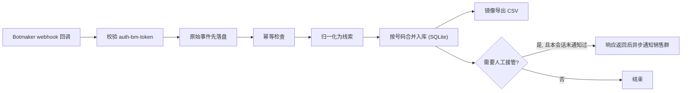

# Webhook 集成服务

> 用途：接收 Botmaker 的 webhook 回调，把对话归一化成线索、去重入库、在需要人工接管时通知销售群。读者：集成工程师。
> 假设：回调结构按 Botmaker 帮助中心示例建模（SOURCES S-B6），真实样本到手前标【待核实】；服务部署在境外，见 `../deployment.md`；Botmaker API 端点与限流见 `../botmaker-api-notes.md`。

## 1. 它做什么



| 步骤 | 说明 |
|---|---|
| 鉴权 | 请求头 `auth-bm-token` 必须等于环境变量 `BOTMAKER_WEBHOOK_TOKEN`，常量时间比较；不符返回 401；未配置密钥时一律返回 503 并记错误日志。可选 `ALLOWED_IPS` 白名单（Botmaker 出口 IP，SOURCES S-B11）。 |
| 先落盘 | 回调原文先写入 `raw_events` 再处理；处理中途出错不丢数据，用 `python -m app.replay` 重放。处理成功后默认清空原文，不在线索库里留聊天内容。Botmaker 的 webhook 10 分钟内失败超过 100 次会熔断 10 分钟，这段时间的回调丢失（SOURCES S-B5），所以请求路径里只有落盘、归一化、入库这类本地操作，尽快应答。 |
| 幂等 | 消息回调按 `messages[]._id_` 识别重复，其余按内容哈希；同一回调重发返回 `duplicate`，不会产生第二条线索或第二次通知。 |
| 归一化 | 全部规则来自共享包 `tromox_lead`：号码转 E.164、国家取号码国家码、首条消息解析来源短码、`language` 变量缺失时用确定性语言检测兜底、会话变量转线索字段（下划线与驼峰写法都认）、路由规则、按 `TAG_TIER` 生成标签。 |
| 合并 | 一个号码一条线索；空值不覆盖已有值，`unknown` 不覆盖已知的 B2B / B2C；来源短码取首次触达；`first_message_ts` / `last_message_ts` 只看客户消息。读改写在 `BEGIN IMMEDIATE` 事务内完成，同号码并发回调不丢更新。 |
| 通知 | `escalation_flag` 为真时，按 `(lead_id, escalation_reason, sessionId)` 只通知一次；坐席发起、没有客户消息的回调（如窗口关闭后销售发模板）不通知；线索已交接（`handed_off` / `contacted`）后，`b2b_qualified` 的重判不再通知，其他原因照常（判定在 `app/normalize.py` 的 `notification_suppressed`，存库的 `escalation_flag` / `escalation_reason` 仍按规则层写）；在 HTTP 响应发出之后由后台任务发送，失败按指数退避重试 3 次，结果记入 `notifications` 表，失败不会让 webhook 返回 5xx。通知慢或失败都不拖累对 Botmaker 的应答（熔断见"先落盘"一行）。 |
| 状态回写 | 坐席消息出现时线索转 `contacted`；`conversation-close` 事件里的结束分类（typification）映射为线索状态，映射表见 `../botmaker-api-notes.md` 第 6 节。【待核实】 |

## 2. 目录

| 路径 | 内容 |
|---|---|
| `app/main.py` | FastAPI 应用工厂：`POST /webhooks/botmaker`、`GET /health` |
| `app/config.py` | 环境变量配置（pydantic-settings），不写死任何密钥 |
| `app/security.py` | 密钥比较与 IP 白名单 |
| `app/models.py` | Botmaker v1.1 回调模型，宽松解析【待核实】 |
| `app/normalize.py` | 回调 → 线索（纯函数，无 I/O） |
| `app/pipeline.py` | 落盘 → 幂等 → 归一化 → 入库 → 通知 |
| `app/store/` | `sqlite_store.py`（主库）、`csv_export.py`（原子重写的 CSV 镜像）、`feishu_bitable.py` 与 `gsheets.py`（占位桩，含字段映射说明，启用即拒绝启动） |
| `app/notify/` | `card.py`（销售摘要卡片）、`feishu.py`、`wecom.py`、`generic.py`、`email_smtp.py` |
| `app/retry.py`、`app/logging_setup.py`、`app/replay.py` | 退避重试、JSON 结构化日志（不含完整号码）、重放工具 |
| `fixtures/` | 6 个回调样例，顶层 `_note` 注明结构【待核实】 |
| `tests/` | pytest，不联网：通知用 `httpx.MockTransport` 与假 SMTP，SQLite 放临时目录；`test_uat_replay.py` 按 `fixtures/uat/manifest.json` 回放 20 条 UAT 用例（第 9 节） |

说明：邮件通知模块命名为 `email_smtp.py` 而不是 `email.py`，避免遮蔽标准库 `email` 包（`smtplib` 依赖它）。

## 3. 从零跑通

```bash
# 在仓库根目录：建虚拟环境并安装共享包 + 服务依赖
uv venv .venv --python 3.11
uv pip install --python .venv/bin/python -e ".[service,dev]"

cd 05-integration/webhook-service
cp .env.example .env            # 至少填 BOTMAKER_WEBHOOK_TOKEN；本地试跑可把 NOTIFIERS 留空
../../.venv/bin/uvicorn app.main:create_app --factory --host 127.0.0.1 --port 8000
```

另开一个终端，用样例回调验证：

```bash
curl -s http://127.0.0.1:8000/health

curl -s -X POST http://127.0.0.1:8000/webhooks/botmaker \
  -H "auth-bm-token: <与 .env 中相同的值>" -H "content-type: application/json" \
  --data @fixtures/message_with_variables_b2b.json
# 期望：{"status":"lead_upserted","kind":"message","lead_id":"L-...","notification_queued":true}
# 同一条再发一次，期望 "status":"duplicate"；不带请求头，期望 HTTP 401
```

线索在 `data/leads.db`，同时镜像到 `data/leads.csv`（UTF-8 带 BOM，Excel 可直接打开）。

## 4. 测试

```bash
cd 05-integration/webhook-service
../../.venv/bin/python -m pytest -q
```

覆盖：鉴权（缺失 / 错误 / 正确 / 未配置）、健康检查、全部 fixture 的归一化、去重（同一回调两次只有一条线索一次通知）、合并语义、驼峰变量、短码与渠道、通知卡片（号码打码、24 小时窗口截止时间）、飞书签名（与 openssl 独立算出的向量比对）、重试、结束分类回写状态、响应先于通知发出、并发更新不丢失、日志不含完整号码。UAT 20 条用例的回放见第 9 节。

## 5. Docker

构建上下文是**仓库根目录**（镜像需要 `pyproject.toml` 与 `shared/`）：

```bash
docker build -f 05-integration/webhook-service/Dockerfile -t tromox-webhook .
docker run -d --name tromox-webhook --restart unless-stopped \
  --env-file 05-integration/webhook-service/.env \
  -v tromox-data:/srv/data -p 127.0.0.1:8000:8000 tromox-webhook
```

国内网络下构建慢时，可加 `--build-arg PIP_INDEX_URL=<PyPI 镜像源>/simple`；境外服务器上不需要。

容器以非 root 用户运行，数据在卷 `/srv/data`。对外暴露与 TLS 由反向代理负责，见 `../deployment.md`。

Docker 只读取构建上下文根目录（即仓库根目录）下的 `.dockerignore`。Dockerfile 只 COPY `pyproject.toml`、`shared/` 与 `app/`，其他目录不会进镜像；若想加快构建时的上下文传输，可在仓库根目录加 `.dockerignore`，排除 `.venv/`、`.git/`、`04-eval/` 与 `**/__pycache__/`。

部署到服务器：见 `../deploy/README.md`（docker compose、Caddy、备份与更新脚本）。

## 6. 配置项

| 变量 | 默认值 | 说明 |
|---|---|---|
| `BOTMAKER_WEBHOOK_TOKEN` | 空 | 必填。与 Botmaker webhook 配置里的 Token 相同；为空时接口返回 503 |
| `ALLOWED_IPS` | 空 | 可选，逗号分隔的 IP 或 CIDR |
| `DATABASE_PATH` | `data/leads.db` | SQLite 主库 |
| `CSV_EXPORT_PATH` | `data/leads.csv` | CSV 镜像 |
| `STORAGE_BACKENDS` | `sqlite,csv` | `sqlite` 恒开；`feishu_bitable`、`gsheets` 为占位桩 |
| `NOTIFIERS` | 空 | 逗号分隔：`feishu`、`wecom`、`generic`、`email`；为空则只记警告不通知 |
| `FEISHU_WEBHOOK_URL`、`FEISHU_SIGNING_SECRET` | 空 | 飞书群自定义机器人地址；开启签名校验时填密钥 |
| `WECOM_WEBHOOK_URL` | 空 | 企业微信群机器人地址 |
| `GENERIC_WEBHOOK_URL` | 空 | 任意接收 JSON POST 的地址 |
| `SMTP_HOST`、`SMTP_PORT`、`SMTP_USERNAME`、`SMTP_PASSWORD`、`EMAIL_FROM`、`EMAIL_TO` | 端口 587 | 邮件通知；465 走隐式 TLS，其余走 STARTTLS |
| `NOTIFY_MASK_PHONE` | `true` | 通知里号码只显示后四位 |
| `BOTMAKER_CHAT_URL_TEMPLATE` | `https://go.botmaker.com/#/chats/{customer_id}` | 卡片上的"接手"链接【待核实】 |
| `TAG_TIER` | `full` | `full` 九个标签维度，`lite` 只有国家与客户类型 |
| `DISPLAY_TIMEZONE` | `Asia/Shanghai` | 卡片上窗口截止时间所用时区 |
| `LOG_LEVEL` | `INFO` | |
| `KEEP_RAW_PAYLOADS` | `false` | **契约外的扩展项**：试用期设为 `true` 可保留回调原文，用来采集真实样本；生产保持 `false` |

通知地址内含密钥，只放在 `.env` 或部署平台的密钥配置里；服务的日志与错误信息不会输出这些地址。

## 7. 运维

```bash
../../.venv/bin/python -m app.replay            # 重放未处理完的回调，重试失败或未发出的通知
../../.venv/bin/python -m app.replay --export   # 另外重写一次 CSV
```

- 重放与重试都是幂等的，可以放进 cron（建议每 5 分钟一次）。
- `/health` 要接告警（做法见 `../deployment.md` 第 5 节）：熔断期间的回调、单条失败后没重发的回调都没落盘，`app.replay` 补不回，只能按 `../botmaker-api-notes.md` 第 7 节对账。
- `notifications.status`：`pending` 已登记未发送、`sent` 全部渠道成功、`partial` 部分成功、`failed` 全部失败、`skipped` 未配置通知渠道。
- 备份只需备份 SQLite 文件，做法见 `../deployment.md`。

## 8. 待核实清单（拿到试用账号后逐条关闭）

1. 真实回调的字段名与层级是否与 fixture 一致，尤其 `contactId`、`customerId`、`messages[]._id_`、`variables`。【待核实】
2. 按钮点击在回调里的形态，以及变量是随用户消息、Bot 消息还是单独事件下发。【待核实】
3. Botmaker 是否接受带下划线的变量名：已知变量 ID 不能含空格、连字符、星号（SOURCES S-B18），下划线原文未写。不接受时用驼峰，服务两种都认；流程、AI Agent 指令里的变量名与标签名要全仓跟着改。【待核实】
4. 回调是否包含分配坐席类事件（`assigned-to-agent`、`queue-set`）；没有时线索在首条坐席消息出现时才转 `contacted`。【待核实】
5. Botmaker 对单条回调失败的重试、间隔与超时策略（熔断规则已证实，见第 1 节"先落盘"一行）。【待核实】
6. CTWA 广告 referral：回调字段表列有 `messages[].whatsappReferral`（`sourceId`、`sourceURL`、`headline`、`body`），JSON 示例里没有（SOURCES S-B12）。服务目前只认名为 `referral` 的对象，照字段表的写法到达时读不到；拿到真实样本核对后再决定是否解析，届时改 `app/models.py` 与 `app/normalize.py`。【待核实】
7. 卡片链接的实际地址格式（公开接口描述里出现过三种写法）。【待核实】
8. 会话变量跨会话保留：流程需在新会话开场时重置 `escalation_flag` 与 `escalation_reason`，否则老客户再次来访会在第一条消息就触发一次通知。【待核实】已交接的线索不受此影响（不再因重判发卡）。
9. `contactId` 是否永远是号码：Botmaker 的公开接口描述里已出现 BSUID（WhatsApp 的商家范围用户标识）相关字段与事件。若部分客户只给出标识而不给号码，"按号码判国家、按号码去重"对这部分客户不成立。服务的处理：WhatsApp 渠道的回调只要带 `customerId`，线索照常入库并照常通知销售，去重键改用 `bm:<customerId>`，`phone` 与 `country_by_phone` 留空（绝不从标识里猜号码），通知卡片提示"国家需向客户确认"；之后若同一客户的号码出现，会补写到同一条线索上。既无号码也无 `customerId`、或来自其他渠道的回调才跳过（结果 `skipped_no_contact`）。真实回调里 BSUID 的形态【待核实】。
10. 已知限制：所有接管原因都通知到同一组渠道；如需把投诉、质保类单独发给售后群，需要按 `escalation_reason` 分流通知（二期）。

## 9. UAT 回放

`fixtures/uat/` 把 `06-acceptance/uat-test-cases.md` 第 2 节的 U01–U20 做成可回放的回调样例：每条用例一到多个回调（`U03a.json`、`U03b.json` 这类后缀是同一用例的先后几条；U17 直接重放 U01 的文件），`variables` 里写的是按钮与 AI Agent 在该场景下应写入的变量——AI 判得对不对不在这里验，验的是"给定这些变量与消息，服务存了什么、通知了几次"。`manifest.json` 每条用例有：`fixtures`（按顺序 POST）、`expect`（全部回调之后的服务层期望：`lead` 存库字段子集、`notifications` 卡片数、`tags`、`priority`、`leads_total`、`notifications_total`、`source`）、可选的 `after`（按第几条回调计的中间检查点，词汇同 `expect`，另加响应 `status`）和 `note`（UAT 表里哪些属 Bot 层不在此验，以及服务层在该用例里具体验什么；U03 / U04 验 WhatsApp 资料名不参与 B 端合格判定，U18 验坐席发起的回调与交接后的重判不发卡）。

```bash
cd 05-integration/webhook-service
../../.venv/bin/python -m pytest -q tests/test_uat_replay.py          # 20 条用例，测试 id 就是 U01…U20
../../.venv/bin/python -m pytest -q tests/test_uat_replay.py -k U17   # 只跑一条
```

拿到 Botmaker 真实回调样本后：按真实结构改 `fixtures/uat/*.json`（字段名、层级、按钮点击在回调里的形态、变量随哪条消息下发），`manifest.json` 里的期望不动，看哪条用例变红就是哪条行为受影响；`app/models.py` 与 `app/normalize.py` 若随样本调整，也以这 20 条全绿为准。W3 集成联调时把这 20 条当执行清单，和 UAT 现场核对的 Bot 话术、时延互补。

## 10. 调优期周报

（本节由 T9 填写：`python -m app.report` 的用法、指标口径与周复盘怎么用。）

## 11. 演示卡片

（本节由 T11 填写：`python -m app.demo` 的用法与产物。）
