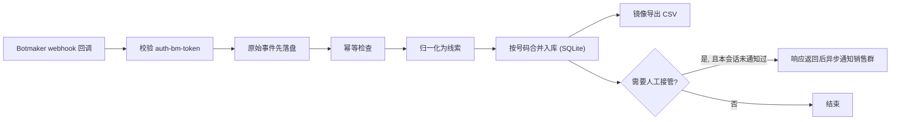

# Webhook 集成服务

> 用途：接收 Botmaker 的 webhook 回调，把对话归一化成线索、去重入库、在需要人工接管时通知销售群。读者：集成工程师。
> 假设：回调结构按 Botmaker 帮助中心示例建模（SOURCES S-B6），真实样本到手前标【待核实】；服务部署在境外，见 `../deployment.md`；Botmaker API 端点与限流见 `../botmaker-api-notes.md`。

## 1. 它做什么



| 步骤 | 说明 |
|---|---|
| 鉴权 | 请求头 `auth-bm-token` 必须等于环境变量 `BOTMAKER_WEBHOOK_TOKEN`，常量时间比较；不符返回 401；未配置密钥时一律返回 503 并记错误日志。可选 `ALLOWED_IPS` 白名单（Botmaker 出口 IP，SOURCES S-B11）。 |
| 先落盘 | 回调原文先写入 `raw_events` 再处理；处理中途出错不丢数据，用 `python -m app.replay` 重放。处理成功后默认清空原文，不在线索库里留聊天内容。Botmaker 的 webhook 10 分钟内失败超过 100 次会熔断 10 分钟，这段时间的回调丢失（SOURCES S-B5），所以请求路径里只有落盘、归一化、入库这类本地操作，尽快应答。 |
| 幂等 | 消息回调按 `messages[]._id_` 识别重复，其余按内容哈希；同一回调重发返回 `duplicate`，不会产生第二条线索或第二次通知。 |
| 归一化 | 全部规则来自共享包 `tromox_lead`：号码转 E.164、国家取号码国家码、首条消息解析来源短码、`language` 变量缺失时用确定性语言检测兜底、会话变量转线索字段（下划线与驼峰写法都认）、路由规则、按 `TAG_TIER` 生成标签。 |
| 合并 | 一个号码一条线索；空值不覆盖已有值，`unknown` 不覆盖已知的 B2B / B2C；来源短码取首次触达；`first_message_ts` / `last_message_ts` 只看客户消息。读改写在 `BEGIN IMMEDIATE` 事务内完成，同号码并发回调不丢更新。CSV 镜像写后合并：单条回调立即写，一阵回调在 `CSV_EXPORT_MIN_INTERVAL_S`（默认 5 秒）内只写一次，服务退出前补写。 |
| 通知 | `escalation_flag` 为真时，按 `(lead_id, escalation_reason, sessionId)` 只通知一次；坐席发起、没有客户消息的回调（如窗口关闭后销售发模板）不通知；线索已交接（`handed_off` / `contacted`）后，`b2b_qualified` 的重判不再通知，其他原因照常（判定在 `app/normalize.py` 的 `notification_suppressed`，存库的 `escalation_flag` / `escalation_reason` 仍按规则层写）；在 HTTP 响应发出之后由后台任务发送，失败按指数退避重试 3 次，结果记入 `notifications` 表，失败不会让 webhook 返回 5xx。通知慢或失败都不拖累对 Botmaker 的应答（熔断见"先落盘"一行）。 |
| 状态回写 | 坐席消息出现时线索转 `contacted`；`conversation-close` 事件里的结束分类（typification）映射为线索状态，映射表见 `../botmaker-api-notes.md` 第 6 节。【待核实】 |
| 指标 | `GET /metrics`（同 Token 鉴权：无配置 503、不对或缺 401；不套 `ALLOWED_IPS`，调用方是服务器自己的 cron）返回最近 24 小时的处理结果分布、通知状态分布、未处理原始事件数、最后一次回调时间与线索总数，只读 SQLite；`?hours=` 可改窗口，范围 1–168，越界返回 400。健康告警脚本据此告警，见 `../deploy/README.md` 第 3 节。 |

## 2. 目录

| 路径 | 内容 |
|---|---|
| `app/main.py` | FastAPI 应用工厂：`POST /webhooks/botmaker`、`GET /health` |
| `app/config.py` | 环境变量配置（pydantic-settings），不写死任何密钥 |
| `app/security.py` | 密钥比较与 IP 白名单 |
| `app/models.py` | Botmaker v1.1 回调模型，宽松解析【待核实】 |
| `app/normalize.py` | 回调 → 线索（纯函数，无 I/O） |
| `app/pipeline.py` | 落盘 → 幂等 → 归一化 → 入库 → 通知 |
| `app/store/` | `sqlite_store.py`（主库）、`csv_export.py`（原子重写的 CSV 镜像）、`feishu_bitable.py` 与 `gsheets.py`（占位桩，含字段映射说明，启用即拒绝启动） |
| `app/notify/` | `card.py`（销售摘要卡片）、`feishu.py`、`wecom.py`、`generic.py`、`email_smtp.py` |
| `app/retry.py`、`app/logging_setup.py`、`app/replay.py` | 退避重试、JSON 结构化日志（不含完整号码）、重放工具 |
| `fixtures/` | 6 个回调样例，顶层 `_note` 注明结构【待核实】 |
| `tests/` | pytest，不联网：通知用 `httpx.MockTransport` 与假 SMTP，SQLite 放临时目录；`test_uat_replay.py` 按 `fixtures/uat/manifest.json` 回放 20 条 UAT 用例（第 9 节） |

说明：邮件通知模块命名为 `email_smtp.py` 而不是 `email.py`，避免遮蔽标准库 `email` 包（`smtplib` 依赖它）。

## 3. 从零跑通

```bash
# 在仓库根目录：建虚拟环境并安装共享包 + 服务依赖
uv venv .venv --python 3.11
uv pip install --python .venv/bin/python -e ".[service,dev]"

cd 05-integration/webhook-service
cp .env.example .env            # 至少填 BOTMAKER_WEBHOOK_TOKEN；本地试跑可把 NOTIFIERS 留空
../../.venv/bin/uvicorn app.main:create_app --factory --host 127.0.0.1 --port 8000
```

另开一个终端，用样例回调验证：

```bash
curl -s http://127.0.0.1:8000/health

curl -s -X POST http://127.0.0.1:8000/webhooks/botmaker \
  -H "auth-bm-token: <与 .env 中相同的值>" -H "content-type: application/json" \
  --data @fixtures/message_with_variables_b2b.json
# 期望：{"status":"lead_upserted","kind":"message","lead_id":"L-...","notification_queued":true}
# 同一条再发一次，期望 "status":"duplicate"；不带请求头，期望 HTTP 401
```

线索在 `data/leads.db`，同时镜像到 `data/leads.csv`（UTF-8 带 BOM，Excel 可直接打开）。

## 4. 测试

```bash
cd 05-integration/webhook-service
../../.venv/bin/python -m pytest -q
```

覆盖：鉴权（缺失 / 错误 / 正确 / 未配置）、健康检查、全部 fixture 的归一化、去重（同一回调两次只有一条线索一次通知）、合并语义、驼峰变量、短码与渠道、通知卡片（号码打码、24 小时窗口截止时间）、飞书签名（与 openssl 独立算出的向量比对）、重试、结束分类回写状态、响应先于通知发出、并发更新不丢失、日志不含完整号码。UAT 20 条用例的回放见第 9 节。

**并发压测**（`tests/test_concurrency.py` 会跑一遍小规模的，也可以手动跑大规模的）：

```bash
cd 05-integration/webhook-service
../../.venv/bin/python tools/loadtest.py --n 200 --concurrency 50 --out /tmp/loadtest.md --json /tmp/loadtest.json
```

它起一个真的 uvicorn 子进程（随机端口，`NOTIFIERS` 为空不联网），用线程池真并发地打 `/webhooks/botmaker`，然后自己打开 SQLite 核对三条不变量：场景 A 同一号码同一会话 n 条回调并发到达 → `processed_events` = n、`leads` = 1、`notifications` = 1（读改写在 `BEGIN IMMEDIATE` 事务里不丢更新，同一线索同一原因同一会话只发一张卡）；场景 B n 个不同号码各一条 → `leads` = n、`notifications` = n；每个请求的 HTTP 往返 p50 / p95 / max 对照 `06-acceptance/thresholds.json` 的 `notify_latency_max_seconds`（60 秒）——注意量的是应答时延，不是端到端通知时延，卡片是应答之后由后台任务发的，端到端 60 秒要在试用期用真实渠道测。不变量全部成立退出 0，否则 1；`--db PATH` 指定库文件、`--keep` 保留临时目录。其余单元测试用的 `TestClient` 在同一个事件循环里串行处理请求，同一时刻只有一条回调在跑，所以验不了并发；这也是为什么这一项要真起服务。

## 5. Docker

构建上下文是**仓库根目录**（镜像需要 `pyproject.toml` 与 `shared/`）：

```bash
docker build -f 05-integration/webhook-service/Dockerfile -t tromox-webhook .
docker run -d --name tromox-webhook --restart unless-stopped \
  --env-file 05-integration/webhook-service/.env \
  -v tromox-data:/srv/data -p 127.0.0.1:8000:8000 tromox-webhook
```

国内网络下构建慢时，可加 `--build-arg PIP_INDEX_URL=<PyPI 镜像源>/simple`；境外服务器上不需要。

容器以非 root 用户运行，数据在卷 `/srv/data`。对外暴露与 TLS 由反向代理负责，见 `../deployment.md`。

Docker 只读取构建上下文根目录（即仓库根目录）下的 `.dockerignore`。Dockerfile 只 COPY `pyproject.toml`、`shared/` 与 `app/`，其他目录不会进镜像；若想加快构建时的上下文传输，可在仓库根目录加 `.dockerignore`，排除 `.venv/`、`.git/`、`04-eval/` 与 `**/__pycache__/`。

部署到服务器：见 `../deploy/README.md`（docker compose、Caddy、备份与更新脚本）。

## 6. 配置项

| 变量 | 默认值 | 说明 |
|---|---|---|
| `BOTMAKER_WEBHOOK_TOKEN` | 空 | 必填。与 Botmaker webhook 配置里的 Token 相同；为空时接口返回 503 |
| `ALLOWED_IPS` | 空 | 可选，逗号分隔的 IP 或 CIDR |
| `DATABASE_PATH` | `data/leads.db` | SQLite 主库 |
| `CSV_EXPORT_PATH` | `data/leads.csv` | CSV 镜像 |
| `STORAGE_BACKENDS` | `sqlite,csv` | `sqlite` 恒开；`feishu_bitable` 把线索镜像到飞书多维表格（需下面四个 `FEISHU_*` 变量，设置步骤见 `05-integration/feishu-bitable-setup.md`）；`gsheets` 为占位桩 |
| `FEISHU_APP_ID` | 空 | 飞书自建应用的 App ID；启用 `feishu_bitable` 时必填 |
| `FEISHU_APP_SECRET` | 空 | 飞书自建应用的 App Secret；密钥，只放 `.env` 或部署平台的密钥配置 |
| `FEISHU_BITABLE_APP_TOKEN` | 空 | 多维表格网址 `/base/` 后的那段 |
| `FEISHU_BITABLE_TABLE_ID` | 空 | 多维表格网址 `table=` 后的那段（`tbl` 开头） |
| `NOTIFIERS` | 空 | 逗号分隔：`feishu`、`wecom`、`generic`、`email`；为空则只记警告不通知 |
| `FEISHU_WEBHOOK_URL`、`FEISHU_SIGNING_SECRET` | 空 | 飞书群自定义机器人地址；开启签名校验时填密钥 |
| `WECOM_WEBHOOK_URL` | 空 | 企业微信群机器人地址 |
| `GENERIC_WEBHOOK_URL` | 空 | 任意接收 JSON POST 的地址 |
| `SMTP_HOST`、`SMTP_PORT`、`SMTP_USERNAME`、`SMTP_PASSWORD`、`EMAIL_FROM`、`EMAIL_TO` | 端口 587 | 邮件通知；465 走隐式 TLS，其余走 STARTTLS |
| `NOTIFY_MASK_PHONE` | `true` | 通知里号码只显示后四位 |
| `BOTMAKER_CHAT_URL_TEMPLATE` | `https://go.botmaker.com/#/chats/{customer_id}` | 卡片上的"接手"链接【待核实】 |
| `TAG_TIER` | `full` | `full` 九个标签维度，`lite` 只有国家与客户类型 |
| `DISPLAY_TIMEZONE` | `Asia/Shanghai` | 卡片上窗口截止时间所用时区 |
| `LOG_LEVEL` | `INFO` | |
| `KEEP_RAW_PAYLOADS` | `false` | **契约外的扩展项**：试用期设为 `true` 可保留回调原文，用来采集真实样本；生产保持 `false` |

通知地址内含密钥，只放在 `.env` 或部署平台的密钥配置里；服务的日志与错误信息不会输出这些地址。

## 7. 运维

```bash
../../.venv/bin/python -m app.replay            # 重放未处理完的回调，重试失败或未发出的通知
../../.venv/bin/python -m app.replay --export   # 另外重写一次 CSV
```

- 重放与重试都是幂等的，可以放进 cron（建议每 5 分钟一次）。
- `/health` 要接告警（做法见 `../deployment.md` 第 5 节）：熔断期间的回调、单条失败后没重发的回调都没落盘，`app.replay` 补不回，只能按 `../botmaker-api-notes.md` 第 7 节对账。
- `notifications.status`：`pending` 已登记未发送、`sent` 全部渠道成功、`partial` 部分成功、`failed` 全部失败、`skipped` 未配置通知渠道。
- 备份只需备份 SQLite 文件，做法见 `../deployment.md`。

**删除请求**（`03-whatsapp/compliance.md` 3.3 节）：一条命令把一个联系人从账本（`leads`、`notifications`、保留期内含其号码或客户 id 的 `raw_events` 原文）、CSV 与多维表格镜像里一次删净；`processed_events` 不动，重投的回调仍按重复处理。

```bash
../../.venv/bin/python -m app.forget --phone +4915112345678 --dry-run   # 只预演：各表行数、会重写哪个 CSV、会调哪些 sink
../../.venv/bin/python -m app.forget --phone +4915112345678             # 同样的预演 + 提示加 --yes，退出 3，不改任何东西
../../.venv/bin/python -m app.forget --phone +4915112345678 --yes       # 执行；也可用 --lead-id L-…
```

- 退出码：`0` 完成（或预演）；`1` 某个 sink 删除失败或飞书配置不全（账本已删的不回滚，修好后重跑即可）；`2` 找不到线索；`3` 既没 `--dry-run` 也没 `--yes`。
- stdout 与日志只出现 `lead_id`，不出现号码；末行固定为 `forgotten lead_id=… leads=… notifications=… raw_events=… csv=rewritten|skipped sinks=…`。
- 备份不在命令范围内：备份里的副本按 `../deployment.md` 第 6 节的保留期自然过期。Botmaker 后台的联系人与会话另行处理。

## 8. 待核实清单（拿到试用账号后逐条关闭）

1. 真实回调的字段名与层级是否与 fixture 一致，尤其 `contactId`、`customerId`、`messages[]._id_`、`variables`。【待核实】
2. 按钮点击在回调里的形态，以及变量是随用户消息、Bot 消息还是单独事件下发。【待核实】
3. Botmaker 是否接受带下划线的变量名：已知变量 ID 不能含空格、连字符、星号（SOURCES S-B18），下划线原文未写。不接受时用驼峰，服务两种都认；流程、AI Agent 指令里的变量名与标签名要全仓跟着改。【待核实】
4. 回调是否包含分配坐席类事件（`assigned-to-agent`、`queue-set`）；没有时线索在首条坐席消息出现时才转 `contacted`。【待核实】
5. Botmaker 对单条回调失败的重试、间隔与超时策略（熔断规则已证实，见第 1 节"先落盘"一行）。【待核实】
6. CTWA 广告 referral：回调字段表列有 `messages[].whatsappReferral`（`sourceId`、`sourceURL`、`headline`、`body`），JSON 示例里没有（SOURCES S-B12）。服务目前只认名为 `referral` 的对象，照字段表的写法到达时读不到；拿到真实样本核对后再决定是否解析，届时改 `app/models.py` 与 `app/normalize.py`。【待核实】
7. 卡片链接的实际地址格式（公开接口描述里出现过三种写法）。【待核实】
8. 会话变量跨会话保留：流程需在新会话开场时重置 `escalation_flag` 与 `escalation_reason`，否则老客户再次来访会在第一条消息就触发一次通知。【待核实】已交接的线索不受此影响（不再因重判发卡）。
9. `contactId` 是否永远是号码：Botmaker 的公开接口描述里已出现 BSUID（WhatsApp 的商家范围用户标识）相关字段与事件。若部分客户只给出标识而不给号码，"按号码判国家、按号码去重"对这部分客户不成立。服务的处理：WhatsApp 渠道的回调只要带 `customerId`，线索照常入库并照常通知销售，去重键改用 `bm:<customerId>`，`phone` 与 `country_by_phone` 留空（绝不从标识里猜号码），通知卡片提示"国家需向客户确认"；之后若同一客户的号码出现，会补写到同一条线索上。既无号码也无 `customerId`、或来自其他渠道的回调才跳过（结果 `skipped_no_contact`）。真实回调里 BSUID 的形态【待核实】。
10. 已知限制：所有接管原因都通知到同一组渠道；如需把投诉、质保类单独发给售后群，需要按 `escalation_reason` 分流通知（二期）。
11. 飞书多维表格镜像（`feishu_bitable`）的接口形态（租户令牌、`records/search` 按 `lead_id` 过滤、创建 / 更新记录、各列类型接受的值）按飞书开放平台公开文档整理，未用真实租户核实；拿到客户租户后按 `05-integration/feishu-bitable-setup.md` 第 6 节验一遍。【待核实】

## 9. UAT 回放

`fixtures/uat/` 把 `06-acceptance/uat-test-cases.md` 第 2 节的 U01–U20 做成可回放的回调样例：每条用例一到多个回调（`U03a.json`、`U03b.json` 这类后缀是同一用例的先后几条；U17 直接重放 U01 的文件），`variables` 里写的是按钮与 AI Agent 在该场景下应写入的变量——AI 判得对不对不在这里验，验的是"给定这些变量与消息，服务存了什么、通知了几次"。`manifest.json` 每条用例有：`fixtures`（按顺序 POST）、`expect`（全部回调之后的服务层期望：`lead` 存库字段子集、`notifications` 卡片数、`tags`、`priority`、`leads_total`、`notifications_total`、`source`）、可选的 `after`（按第几条回调计的中间检查点，词汇同 `expect`，另加响应 `status`）和 `note`（UAT 表里哪些属 Bot 层不在此验，以及服务层在该用例里具体验什么；U03 / U04 验 WhatsApp 资料名不参与 B 端合格判定，U18 验坐席发起的回调与交接后的重判不发卡）。

```bash
cd 05-integration/webhook-service
../../.venv/bin/python -m pytest -q tests/test_uat_replay.py          # 20 条用例，测试 id 就是 U01…U20
../../.venv/bin/python -m pytest -q tests/test_uat_replay.py -k U17   # 只跑一条
```

拿到 Botmaker 真实回调样本后：按真实结构改 `fixtures/uat/*.json`（字段名、层级、按钮点击在回调里的形态、变量随哪条消息下发），`manifest.json` 里的期望不动，看哪条用例变红就是哪条行为受影响；`app/models.py` 与 `app/normalize.py` 若随样本调整，也以这 20 条全绿为准。W3 集成联调时把这 20 条当执行清单，和 UAT 现场核对的 Bot 话术、时延互补。

## 10. 调优期周报

`app/report.py` 从线索库出一份周复盘报告（Markdown + JSON），给 `../../07-project/timeline.md` W5–W8 的每周误判复盘用；`../../07-project/phase-2-outline.md` 第 1 节要在调优结束时回看的几个数（线索数与 B 端占比、有效线索率按渠道 / 短码、升级率与通知时延）都在里面。它只读打开 SQLite（`mode=ro`），不经过服务，不改库，随时可跑；默认不发通知，加 `--post` 才把摘要推到销售群（见本节末「自动推送」）。

```bash
cd 05-integration/webhook-service
../../.venv/bin/python -m app.report --out report.md --json report.json                       # 最近 7 天，库取 .env 的 DATABASE_PATH
../../.venv/bin/python -m app.report --db data/leads.db --since 2026-11-09 --until 2026-11-16 --out w6.md --json w6.json
../../.venv/bin/python -m app.report --out report.md --latency-threshold 30                     # 收紧通知时延阈值
```

窗口口径：`--until` 默认今天（UTC 日期）、`--since` 默认往前 7 天，区间是 `[since, until)`，**`until` 当天不算**，所以周一早上直接跑就是上一整周。线索按 `leads.updated_at` 落在窗口内计（一条线索本周有任何更新就算进来，包括状态回写），通知按 `notifications.created_at` 计。

六个指标怎么读（JSON 的键名与 Markdown 的节号一一对应）：

| 节 | JSON 键 | 口径 | 看什么 |
|---|---|---|---|
| 1 线索 | `leads`、`valid_lead_rate` | `b2b_share = b2b / total`；`valid_lead_rate` 是**代理指标**：状态为 `handed_off` / `contacted` / `closed_won` 的 B 端线索 ÷ B 端线索，B 端为 0 时为 `null` | 量够不够；结束分类（`04-eval/labeling-guide.md`）攒够之后要换成"销售填的有效线索标准" |
| 2 来源 | `by_source_channel`、`by_source_code` | 渠道列全部枚举值（含 `unknown`）；短码只列前 20 | 哪条内容带来真经销商；`unknown` 占比持续高于三成要回头查链接（`../../01-design/source-tracking.md` 第 7 节） |
| 3 转人工 | `escalation` | `rate = flagged / total`；`by_reason` 各值之和等于 `flagged` | 对照 `../../06-acceptance/thresholds.json` 的 `escalation_rate_max`；`b2b_qualified` 是设计上必转的，误判看 `low_confidence` 与 `not_understood_twice` |
| 4 通知 | `notifications` | 五种状态各计一次（含义见第 7 节）；时延 = `sent_at − created_at`（秒，只算有 `sent_at` 的行）；`over_threshold` 是超过 `--latency-threshold`（默认 60，与 `thresholds.json` 的 `notify_latency_max_seconds` 一致）的条数 | `failed` / `pending` 非 0 或 `over_threshold` 非 0，先查通知渠道与 `app.replay` |
| 5 状态漏斗 | `status_funnel` | 八个状态各一格，合计等于 `leads.total` | `handed_off` 之后靠销售回写；长期停在 `qualified` 是回写没跟上 |
| 6 复盘清单 | （只在 Markdown） | 窗口内 `low_confidence` / `not_understood_twice` 的线索：`lead_id`、原因、尾号 4 位、`ai_summary` | 本周逐条人工复看，判断是 prompt、知识库还是流程的问题 |

隐私：报告会贴到群里，所以号码只出尾号 4 位，摘要里像号码的数字串也一并打码；`lead_id` 是哈希，可拿去 `data/leads.csv` 或 Botmaker 后台对账。

周复盘怎么用（W5–W8）：每周一跑一次，`report.md` 整份贴进当周复盘记录；先看第 6 节逐条定性（AI 判错 / 客户表达含糊 / 流程漏洞），再看第 3 节升级率和第 4 节时延有没有越线，最后把第 1、2 节的数按周排成一列看趋势。要看四周的变化，把每周的 `report.json` 留下来即可，键名固定。

### 自动推送（`--post`）

不加 `--post` 时行为和以前完全一样。加上之后，报告照常生成，再把上面六个指标压成一段摘要，发到第 6 节 `NOTIFIERS` 里配的每个渠道（飞书富文本、企业微信 markdown、通用 webhook 的 `{"type": "text", "title": …, "text": …}`、邮件的纯文本正文，主题就是标题）。标题是 `调优期周报 <since> 至 <until>`，正文不超过 20 行，六行分别对应上表的六节：线索数与 B 端占比、来源前 3、转人工率与原因前 3、通知 sent / partial / failed 与 p95、状态漏斗、复盘清单条数。

```bash
cd 05-integration/webhook-service
../../.venv/bin/python -m app.report --out report.md --post          # 出报告 + 推送
../../.venv/bin/python -m app.report --post                          # 只推送，不落盘
```

摘要里只有汇总数：没有 `lead_id`、没有 `ai_summary`、一个号码都没有（第 6 节的逐条清单仍然只在 `report.md` 里），所以推给销售群比整份报告更安全。

每周一 09:00 自动发一次，宿主机 crontab 写：

```cron
0 9 * * 1 docker exec tromox-webhook python -m app.report --post >> /var/log/tromox-report.log 2>&1
```

容器里的 `NOTIFIERS` 等配置沿用第 5 节的 `--env-file`，不用再传一遍；`--db` 不给就取 `DATABASE_PATH`，窗口不给就是「上一整周」，所以周一早上这一条命令就够了。

怎么看结果：

| 情况 | stdout | 退出码 | 怎么办 |
|---|---|---|---|
| 全部渠道成功 | `posted=feishu,wecom` | 0 | 无 |
| 一部分渠道失败 | `posted=feishu`（成功的那些） | 1 | stderr 有失败渠道名，详情看 error 日志的 `周报推送失败`，再照第 7 节查那个渠道 |
| 全部失败 | `posted=none` | 1 | 同上；`posted=none` 配退出码 1 就是「一个都没发出去」 |
| 没配 `NOTIFIERS` | `posted=none` | 0 | 这不算失败；要推送先按第 6 节配渠道 |

失败不会打断其余渠道：每个渠道各发各的，失败的记一条 error 日志（和通知一样，日志与报错里都不会出现带密钥的 webhook 地址），全部发完才决定退出码。cron 用退出码判断即可，非 0 就去看日志。

## 11. 演示卡片

Botmaker 开通之前，客户和销售都没见过"销售群里收到的卡片"长什么样。`python -m app.demo` 不起服务、不联网，把第 9 节的 U01–U20 逐条回放（每条用例各用一个临时 SQLite 和一个 `Pipeline`，走的是和线上完全一样的解析、归一化、去重与卡片渲染），把销售本来会收到的卡片收集起来写成文件，可以直接拿给客户看。

```bash
cd 05-integration/webhook-service
../../.venv/bin/python -m app.demo --out ../../scratch/demo                       # 全部 20 条
../../.venv/bin/python -m app.demo --out ../../scratch/demo --cases U01,U20      # 只回放几条
../../.venv/bin/python -m app.demo --out ../../scratch/demo --now 2026-11-10T12:00:00Z --timezone Asia/Shanghai
```

`--now` 指定回放时的"当前时刻"（默认当前 UTC 时间），卡片上"24 小时窗口截止 … 剩余约 N 小时"按它算，固定它就能每次产出一样的文件；`--timezone` 是截止时间的展示时区，默认 `Asia/Shanghai`。`--cases` 写了不存在的用例号时退出码为 2。stdout 每条用例一行进度，末行 `cases=<n> cards=<m> out=<目录>`。

`--out` 目录下的五个产物：

| 产物 | 内容 | 给谁看 |
| --- | --- | --- |
| `cards.md` | 每张卡片的 Markdown（`LeadCard.to_markdown()` 原文），按用例分组，不发卡的用例注明"只入库、不通知" | 客户、销售：看卡片上有哪些字段 |
| `cards.html` | 同一批卡片的单文件网页，内联 CSS、不引用任何外部资源，每张卡一个 `<article data-case="U01">`，带优先级角标（高 = 红、普通 = 蓝）和"接手"按钮样式（按钮不跳转） | 客户、销售：直观感受版式；浏览器直接打开 |
| `summary.md` | 一张表：用例、场景、回调数、卡片数、接管原因、最终状态 | 张宝文、总管：一眼看 20 条各发了几张卡 |
| `leads.csv` | 每条用例回放后线索库里的全部线索，表头 = `tromox_lead.LEAD_FIELDS`，和第 1 节的 CSV 镜像同一列序 | 对照卡片看线索库存了什么 |
| `payloads/<用例>-<n>.feishu.json` | 每张卡对应的飞书机器人请求体（`FeishuNotifier.build_body()` 原样），不发送 | 联调飞书群机器人时对照字段 |

给客户看之前注意：

- **数据全部虚构**。公司、姓名、号码、对话都是 `fixtures/uat/` 编的，与任何真实客户无关；卡片上出现的号码只有尾号 4 位（线上默认 `NOTIFY_MASK_PHONE=true`）。`leads.csv` 是线索库导出，含完整（虚构）号码，别把它和卡片一起发给客户。
- **卡片样式以飞书 / 企业微信实际渲染为准**。`cards.html` 只是示意版式；飞书按 `payloads/` 里的 interactive card 渲染，企业微信按 Markdown 渲染，字段顺序和文字一致，外观由各平台决定。
- 卡片"接手"链接的真实地址格式还没核实（第 8 节第 7 条），演示里按 `BOTMAKER_CHAT_URL_TEMPLATE` 的默认值生成。
- 回放用的是 UAT 用例里预设的 AI Agent 变量，AI 判得对不对不在这里验（同第 9 节）；这套卡片展示的是"给定这些判断，销售会看到什么"。

## 12. 数据保留

`03-whatsapp/compliance.md` 第 4 节承诺：线索记录在最后一次联系后 24 个月删除或匿名化，原始回调事件 90 天自动清理。第 7 节的 `app.forget` 是"客户提出删除请求时删一条"，这一节的 `app.retention` 是同一承诺的定时那一半——按保留期到期就删，一个月跑一次。

```bash
cd 05-integration/webhook-service
../../.venv/bin/python -m app.retention --dry-run   # 只预演：到期线索（按 segment 分列）、到期原始事件、孤儿通知各多少条
../../.venv/bin/python -m app.retention             # 同样的预演 + 提示加 --yes，退出 3，不改任何东西
../../.venv/bin/python -m app.retention --yes       # 执行
../../.venv/bin/python -m app.retention --yes --older-than-days 365 --raw-events-days 30   # 改保留期
```

一次运行删四样东西，口径如下：

| 对象 | 判定 | 说明 |
|---|---|---|
| 到期线索 | 参考时间早于 `now − --older-than-days`（默认 730 天 = 24 个月） | 参考时间取线索的 `last_message_ts`；线索从没记下过消息时间时，取 `leads.updated_at`（注意 `updated_at` 是"最后一次写这行"，改个状态也会刷新它，所以这种线索的保留期起算点可能晚于真实的最后联系时间——宁可多留不可错删）。**`status` 不影响判定**：`handed_off`、`contacted` 的线索同样按时间删——保留期就是保留期。两个时间都读不出来的行保留（只删证据确凿的） |
| 到期原始事件 | `raw_events` 里 `processed = 1` 且 `received_at` 早于 `now − --raw-events-days`（默认 90 天） | 不管 `payload_json` 是否已被 `mark_processed` 清空都删：到期后连时间戳和事件键也不留。未处理的行不动，那是 `app.replay` 的活 |
| 孤儿通知 | `notifications` 里 `lead_id` 已不在 `leads` 表的行 | 线索删了、通知记录没跟着删的历史残留 |
| CSV 镜像 | 真删掉线索时整批重写一次 | 一次运行重写一次，不是一条线索重写一次 |

- 每条到期线索走的是 `app.forget` 里的同一个 `forget_lead()`：账本（`leads`、`notifications`、保留期内含其号码或客户 id 的 `raw_events` 原文）与飞书多维表格镜像一起删，`processed_events` 不动。
- 退出码：`0` 完成（或预演）；`1` 某个 sink 删除失败或飞书配置不全（账本已删的不回滚，修好后重跑即可）；`3` 既没 `--dry-run` 也没 `--yes`。
- stdout 与日志**连 `lead_id` 都不出现**，只有计数（一次运行可能涉及成千上万条）；末行固定为 `retention leads=… raw_events=… notifications=… csv=rewritten|skipped sinks=…`，日志只有一行 `retention finished`。
- `--now YYYY-MM-DD` 把"今天"固定成某个 UTC 日期，只给测试与演练用，默认当前 UTC 日期。
- cron 建议每月 1 日 04:00 跑一次（避开 03:15 的备份），写法见 `../deploy/cron.example`；先用 `--dry-run` 看一眼条数，确认口径没问题再挂 `--yes`。那行把输出接到 `logger -t tromox`，末行计数与 sink 失败的 error 日志都进系统日志，`journalctl -t tromox` 能查到。
- 备份不在命令范围内：备份里的副本按 `../deployment.md` 第 6 节的保留期自然过期。Botmaker 后台的会话记录由平台自己按天数删除（`03-whatsapp/compliance.md` 第 4 节）。
