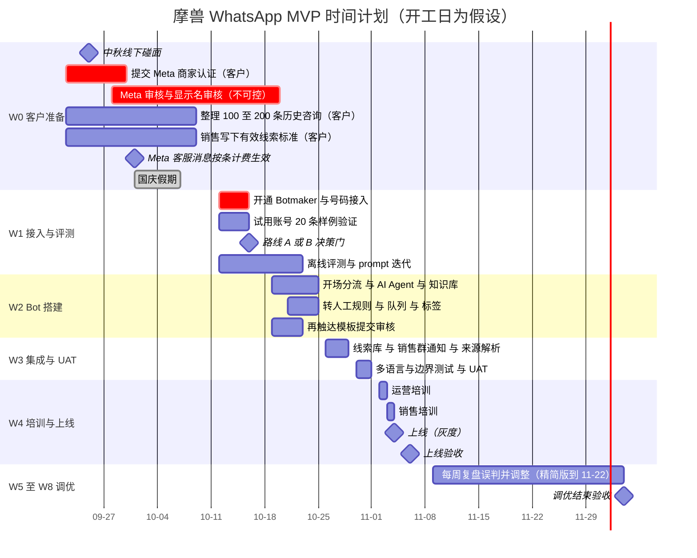

# 时间计划

> 用途：项目日期的唯一源头，其他文档引用这里的日期，不各自写。读者：张宝文、集成工程师；方案书的时间计划一节由此简化而来。
> 假设：开工日 2026-10-12（国庆假期后第一个完整周的周一）为假设【张宝文确认】；国庆假期按 2026-10-01 至 2026-10-07 计，以国务院公布为准；调优期按完整版 4 周画，精简版为 2 周（到 2026-11-22）。

## 1. 关键日期

| 日期 | 事件 | 说明 |
|---|---|---|
| 2026-09-18 | Kim 提出需求 | |
| 2026-09-21 | 方案包初稿 | 本仓库 |
| 2026-09-25 前后 | 中秋线下碰面 | 张宝文与客户捋三个流程，见 `meeting-prep.md` |
| 2026-09-30 前 | 客户提交 Meta 商家认证 | **关键路径起点**，越早越好 |
| 2026-10-01 | Meta 客服消息按条计费生效 | 成本按新规则算，见 `03-whatsapp/cost-model.md` |
| 2026-10-01 至 2026-10-07 | 国庆假期 | Meta 审核不放假，材料要在节前交 |
| 2026-10-12 | 正式开工（W1） | 假设【张宝文确认】 |
| 2026-10-16 | 路线 A/B 决策门 | 试用账号 20 条样例结果 |
| 2026-10-30 | UAT 开始 | |
| 2026-11-02、2026-11-03 | 运营培训、销售培训 | 先培训后上线 |
| 2026-11-04 | 上线（灰度：先放一个渠道链接） | 避开周五 |
| 2026-11-06 | 上线验收 | |
| 2026-11-22 | 精简版调优结束 | |
| 2026-12-04 | 完整版调优结束验收 | |

## 2. 甘特图

## 3. 关键路径说明

1. **Meta 商家认证与显示名审核是唯一不受我们控制的环节。** Meta 官方口径为商家认证审核最长 14 个工作日（快则 10 分钟，SOURCES S-M8），9/30 提交最晚约 10/20 出结果；被退回重交则要再走一轮，可能拖到数周。所以要求客户在节前提交，不等开工。
2. 认证未过时的退路（已按 Meta 原文核实，SOURCES S-M8）：未认证的商务组合可以无上限地回复客户主动发起的会话，入站链路先上线（客户先发消息、我们在窗口内回复），同时继续走认证；限制是主动发起每 24 小时最多触达 250 个去重用户、最多 2 个号码，且显示名审核通过前只出现在号码资料页、不出现在客户的聊天顶部。见 `03-whatsapp/meta-onboarding-checklist.md` 第 8 节。
3. 号码走 Coexistence 路线时，接入当天需要持有该手机的人在场扫码。
4. 再触达模板需 Meta 预审，W2 第一天就提交，不放到 UAT 才提。
5. 历史咨询与有效线索标准在开工日（2026-10-12）前到位，否则离线评测顺延，W1 至 W3 整体后移。
6. WhatsApp 消息费的支付方式：Meta 规定 10/1 起账户上没有支付方式的，每号码每月 1,000 条免费服务消息用完即停投（SOURCES S-M9）；经 Botmaker 接入时由谁绑定【待核实】，节前向 Botmaker 书面确认，接入当天落实（`03-whatsapp/meta-onboarding-checklist.md` 第 2 节第 7 项）。

## 4. 每周产出

| 周 | 产出 | 负责人 |
|---|---|---|
| W0 | 商家认证已提交；历史咨询导出；有效线索标准；碰面结论 | 客户、张宝文 |
| W1 | 号码接入完成；A/B 决策记录；首版离线评测报告 | 集成工程师 |
| W2 | 可对话的 Bot（测试号）；知识库首版；模板已提交 | 集成工程师、客户运营 |
| W3 | 线索入库与通知打通；UAT 记录 | 集成工程师、客户销售 |
| W4 | 两场培训；上线；上线验收单 | 全体 |
| W5 至 W8 | 每周误判复盘记录；prompt 与知识库版本更新；调优结束验收 | 集成工程师、客户运营 |
